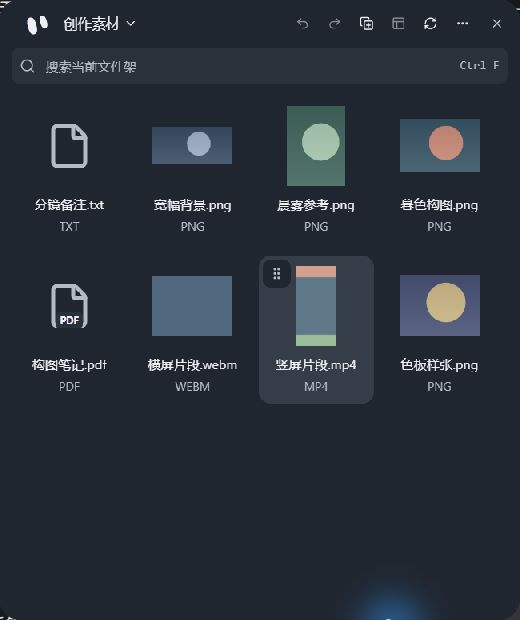
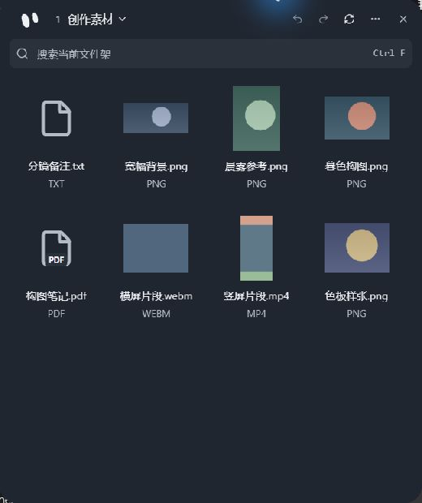
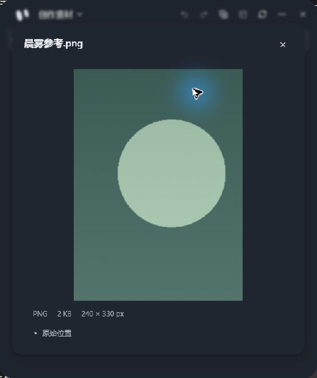

# 柠猫文件工作站 · Ningmao File Workstation

Windows 优先的本地素材工作站。用悬浮小球打开文件架，快速收集、整理、预览文件，再拖到正在工作的应用里。

**当前开发基线：`develop` · D13 Windows x64 候选。** 应用源码 `01f99f2`，含首屏优先、有限预取和有上限的本地缩略图缓存。尚未发布稳定版。

[试用与构建](#试用与构建) · [当前验证](docs/execution/ACTIVE-DELIVERY.md) · [功能状态](docs/project-status.md) · [路线图](docs/roadmap.md) · [开发入口](docs/codex-start-here.md)

## 现在的界面

| 文件架 | 独立子窗 | 快速预览 |
| --- | --- | --- |
|  |  |  |

文件架、子窗和预览来自 D13 Windows WebView2 候选，使用合成素材；小球来自同一源码的浏览器测试界面。

## 可以做什么

- **收集与整理**：普通文件架保留引用；绑定目录按安全复制规则导入，同名保留双方。支持拖出、多选、标签、排序和工作区撤销。
- **多窗口与快速预览**：小球与主文件架共享位置，独立子架可快速收回。空格预览、双击用默认软件打开。PDF 可翻页，DOCX、PPTX、XLSX 支持简化只读预览。
- **本地检索**：在当前架或跨架查名称和标签，支持类型筛选。正文检索留待后续。
- **互传候选**：已有局域网发现、设备核对和发送接收流程，以及 WebRTC 互传候选。真实双设备、不同网络和手机端仍需专项验收；账号登录和持续同步未交付。

## 试用与构建

本地便携候选为 `Ningmao-D13-01f99f2.zip`，需要 Windows x64 和 WebView2。解压后双击 `Start-Ningmao.vbs`，已有工作区会自动接续。保留最近三个本地候选，程序包和工作区分开。见[试用说明](docs/first-preview-quickstart.md)与[交付校验](docs/execution/ACTIVE-DELIVERY.md)。

公开仓库没有永久安装包下载。可从源码构建，或在有效期内获取 [GitHub Actions 的 Preview package 工件](https://github.com/2539426035852ningmao-cmyk/ningmao-file-workstation/actions/workflows/preview-package.yml)。工件是未签名测试包，核对 `build-manifest.json` 的来源提交后再使用。

| 目录 | 内容 |
| --- | --- |
| [apps/desktop](apps/desktop) | Tauri + Rust + React 主工程 |
| [apps/web](apps/web) | 浏览器互传与信令候选 |
| [crates](crates) | 共享协议及传输组件 |
| [scripts](scripts) | 回归、构建与便携打包 |
| [docs](docs/README.md) | 当前状态、开发说明与历史证据索引 |

下一阶段先验证设备发现、配对和传输失败恢复，再推进账号绑定、多端互传、跨账号分享及同步。历史 `main`、早期样机与 PR 保留供追溯。

[贡献指南](CONTRIBUTING.md) · [设计规范](design.md) · [许可证](LICENSE) · [第三方来源](docs/third-party.md)
