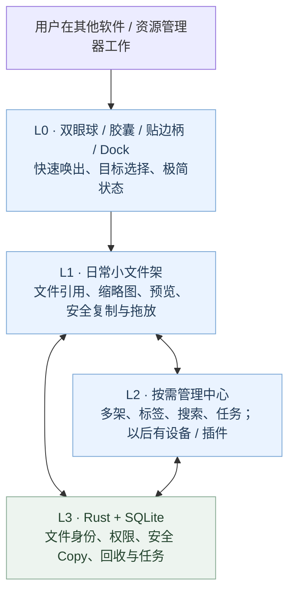

# 柠猫文件工作站 · Ningmao File Workstation

> **Windows 10/11 优先 · 免费开源 · 本地优先 · 轻量悬浮素材工作站**  
> **当前状态（2026-10-26 快照）：P2 r21 功能候选开发中，GitHub CI 通过，Windows 原生全矩阵仍为 PARTIAL；没有正式稳定 Release。**
> 本仓库 `main` 目前以规范、研究及原型为主，最新桌面应用实现在尚未合并的堆叠 PR 中。不要把设计图、候选安装包或 CI 成功误读为正式软件发布。

[查看当前真实进度](docs/project-status.md) · [了解产品](PRODUCT.md) · [Codex 开工入口](docs/codex-start-here.md) · [设计规范](design.md) · [全部文档](docs/README.md) · [贡献指南](CONTRIBUTING.md)

## 一眼认识柠猫

**随手收集 → 安全整理 → 在其他软件中使用 → 以后可以跨设备互传与按需智能检索。**

- **临时文件架：** 添加文件默认只保留引用，不偷移原文件
- **绑定目录文件架：** 导入文件默认安全复制，同名保留双方
- **双眼悬浮入口：** 球 / 胶囊 / 轻预览 / 完整文件架，可贴边或 Dock 组合
- **按需管理中心：** 标签、文件检索、批量操作和任务反馈集中处理，不挤占日常小文件架
- **本地安全：** 文件来源、SQLite 数据、软回收及系统回收要可追踪、可恢复

> 以上部分能力已在 P0/P1/P2 **候选分支**实现和测试；仍需逐版本 Windows 原生集成验收。P3 网络与 P4 AI/插件属于后续阶段，尚无正式交付。

## 视觉与交互展示

**产品分层（架构/功能关系示意，不是当前全部界面都已交付）：**

**现有视觉研究截图（浏览器样机证据，不代表 r21 Windows 原生全验收）：**

[查看 r16 样机与实测证据](https://github.com/2539426035852ningmao-cmyk/ningmao-file-workstation/tree/97f779ee900ed10231a2ab18a562812afffcbd87/docs/research/dual-eye-orb-evidence) · [双眼球设计合同](https://github.com/2539426035852ningmao-cmyk/ningmao-file-workstation/blob/feat/dual-eye-orb/docs/design/dual-eye-orb-v1.md)

## 当前开发进度（截至 2026-10-26）

| 阶段 | 代码/研究实际情况 | 可否视作已正式交付 |
|---|---|---|
| M1-01～03 | 仓库治理、Windows 技术对比、双 UI 研究已合入 `main` | **研究完成**，不是正式主应用 |
| **P0/P1** [#30](https://github.com/2539426035852ningmao-cmyk/ningmao-file-workstation/pull/30) | 引用/安全 Copy、SQLite、预览、多选、排序与紧凑文件架候选 | **未合并主线，仍待整体验收** |
| **P2** [#32](https://github.com/2539426035852ningmao-cmyk/ningmao-file-workstation/pull/32) → [#35](https://github.com/2539426035852ningmao-cmyk/ningmao-file-workstation/pull/35) → [#36](https://github.com/2539426035852ningmao-cmyk/ningmao-file-workstation/pull/36) → [#40](https://github.com/2539426035852ningmao-cmyk/ningmao-file-workstation/pull/40) | 双眼球、Dock、多架、管理中心、回收流程、r21 快捷键/找回 | **r21 部分原生通过，完整 P2 未放行** |
| **P3** | LocalSend-first 协议候选与零新增柠猫服务器费的 LAN 设计合同 | **研究/规划**，未做正式双机互传 |
| **P4** | SQLite/FTS5 本地搜索方案 + 44 项产品决策；AI/插件分段实施合同 | **规划/选型**，未正式上线 |

**最新 r21 证据：** 99 项浏览器测试、69 项 Rust 测试（另有按现有规则忽略的受控入口），[Desktop CI](https://github.com/2539426035852ningmao-cmyk/ningmao-file-workstation/actions/runs/40295641668) 与 [Preview CI](https://github.com/2539426035852ningmao-cmyk/ningmao-file-workstation/actions/runs/40295641558) 均成功。Windows 11 实机仅确认默认快捷键唤出/暂停/恢复等部分动作，跨窗真实 Copy、回收、DPI/多屏等仍待集中验收。[精确矩阵见候选分支](https://github.com/2539426035852ningmao-cmyk/ningmao-file-workstation/blob/feat/p2-management-flow/docs/research/P2-closeout-evidence/native-matrix.json)。

## 发展路线：先做稳，再扩展

以**真实文件安全、原生可用、可回滚、无默认付费服务**为门槛；网络端口、云端隐私上传、模型下载、R3 数据迁移和正式代码合并要另行符合批准流程。无联网的隔离合成试验可以提前做，不能宣称正式功能通过。

## 技术选型与协作

- **Windows 桌面候选：** Tauri 2 / Rust / React / TypeScript / SQLite
- **视觉：** shadcn/ui、Radix、Lucide，按需复用 SpaceUI 文件组件；深浅主题、默认蓝色强调色
- **协议：** Apache-2.0 主仓库，第三方许可证独立审核；官方发行版目标免费
- **开发流程：** Codex → 功能分支 / PR → CI → Windows 实机证据 → 阶段审批 → 安全合并
- **基线决策：** [原 43 项](docs/product-decisions.md) + [P4 独立 44 项](docs/product/P4-confirmed-decisions-01-44-2026-10-26.md)，两者不能互相覆盖

[查看系统设计和阶段证据](docs/project-status.md) · [待讨论的关键决策](docs/open-decisions.md) · [P2→P3→P4 交付合同](docs/execution/P2-to-P3-P4-sequential-delivery-2026-10-26.md)

### 开发者注意

`main` 目前没有完整 `apps/desktop` 正式发行工程；请从 [Codex 入口](docs/codex-start-here.md)确认最新 PR 基线。**不要根据旧 PR #9/#11/#13 的历史文档复制一套主应用，也不要将用户私人文件、Token 或真实数据库放入公开仓库。**
