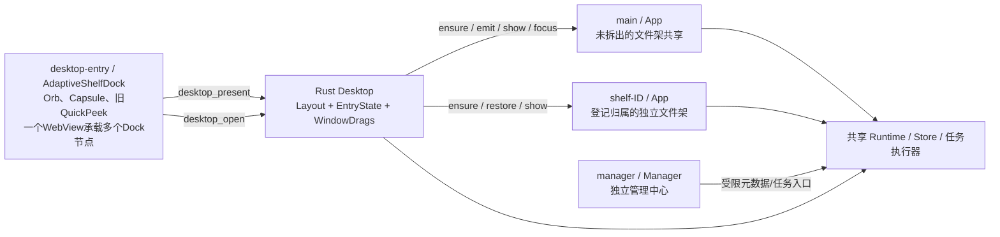
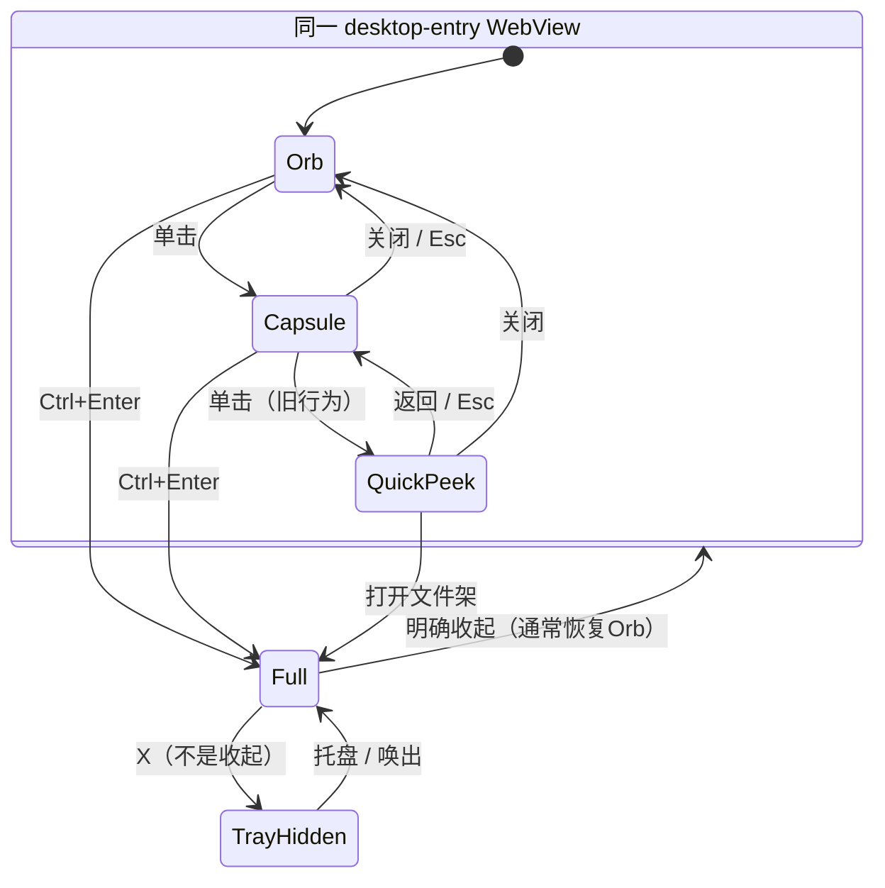

# MORPH-01 · 三形态窗口交接技术探针

日期：2026-11-06（Asia/Hong_Kong）。**结论：只读审计完成，路线待审阅；没有实施 Fluid Morph，没有修复或发布新候选。**

## 1. 基线、范围与结果

本报告依据用户最新交接、[design.md](../../design.md)、[D05](../product/D05-fluid-workspace-and-theme-contract-2026-11-05.md)、[功能审计](feature-and-workflow-audit.md)、[验收清单](../development/ui-acceptance-checklist.md)，并核对原43项、P4独立44项、项目状态与路线。D05明确更新旧形态/主题规则，其余文件安全要求不变。最新用户交接进一步确定直接大展开优先恢复上次活动持久架，不重开需求问卷。

审计没有改业务代码、IPC、权限、数据库、窗口运行逻辑、主题或QuickPeek。测试调用既有真实实现；原生观察使用已存在r7和新建空数据目录，未读取用户数据库、导入私人素材、联网传文件或调用模型。没有新增依赖或复制第三方代码；本轮是本地代码审计，无需重新研究动画库。

| 对象 | 精确快照 | 实际状态 |
|---|---|---|
| main | fc8903dc3a34a17707db3a9cbd12f631baaef71b | 治理/研究基线，完整桌面工程未合入 |
| [#62](https://github.com/2539426035852ningmao-cmyk/ningmao-file-workstation/pull/62) | ffb8bc8ea8568544e28ec5e0103c6f064b15a4e9 | open / Draft / mergeable；base #61，1a09bde4a356bf54af6eec594f92fbc7adc120fd |
| [#63](https://github.com/2539426035852ningmao-cmyk/ningmao-file-workstation/pull/63) | d141eb7ddf45a81b664cf967502a26d5c21ba64b | open / 非Draft / mergeable；base main，纯状态文档 |
| [#64](https://github.com/2539426035852ningmao-cmyk/ningmao-file-workstation/pull/64) | 3eb5beefb82a0d86d6d4409d4726784fd1c2611c | open / 非Draft / mergeable；base main，D05设计规范 |
| 本审阅分支 | docs/morph-01-technical-probe-20261106 | 基于#64，只增加审计/证据和审计导航；不携带#62应用代码 |

工作开始时#62工作区干净；测试后从#64建立纯审计分支。#63与#64为main上的同级文档PR，#62依赖#61及其应用祖先，三者不能按编号直接串行合并。本PR仅依赖#64的规范文本，源码证据固定指向#62，后续实施仍应从实际应用候选建立独立分支。未合并任何PR。

已实时核验CI：#62 Desktop [42036118406](https://github.com/2539426035852ningmao-cmyk/ningmao-file-workstation/actions/runs/42036118406)、Preview [42036118562](https://github.com/2539426035852ningmao-cmyk/ningmao-file-workstation/actions/runs/42036118562)、P3 [42036118469](https://github.com/2539426035852ningmao-cmyk/ningmao-file-workstation/actions/runs/42036118469)均success；#63 [42035928128](https://github.com/2539426035852ningmao-cmyk/ningmao-file-workstation/actions/runs/42035928128)、#64 [42048994350](https://github.com/2539426035852ningmao-cmyk/ningmao-file-workstation/actions/runs/42048994350)仓库检查success。这些结果不继承给本审计提交。

r7没有重打包。应用构建源码为b960dcb2bb298557abb97029333ed91a698fd956；本轮审计HEAD ffb8bc8之后只有文档增量。复核EXE SHA256：
`5423d50d17345b5ece8e903a80807563540482b16cd7e3d4440f0c19ee9451ac`。
ZIP SHA256：
`51e06036d0223f18e00dac8dc72d4a8338144a0e6ae38b6c5b840ae4c91c749a`。
仍是未签名debug测试包，不是正式发布或D05样机。

## 2. 当前架构与生命周期



| 窗口 | 创建/保留/销毁 | 几何、焦点与权限 |
|---|---|---|
| desktop-entry | setup创建一次；无入口时hide，不销毁 | 初始64×64逻辑px；不进任务栏、不可手动resize、透明、no_redirection_bitmap；入口置顶偏好独立；Entry专用命令，不拥有普通文件窗口scope |
| main | Tauri配置创建；收起与X均hide，保留WebView；完整退出结束 | 默认420×520，最小340×320；按main_geometry恢复；main_topmost与入口不同；非拆出架共用 |
| shelf-ID | ensure按已登记ID惰性创建，创建mutex防重复；收起hide；合并回main时destroy | 同样420×520、340×320；各自geometry/topmost；scope固定为登记架，不能变成任意架文件权限 |
| manager | 已存在则show/unminimize/focus，否则创建；X允许默认关闭/销毁 | 1040×720、最小760×520；独立于三形态，不迁入App面板 |

入口：[main.tsx](https://github.com/2539426035852ningmao-cmyk/ningmao-file-workstation/blob/ffb8bc8ea8568544e28ec5e0103c6f064b15a4e9/apps/desktop/src/main.tsx#L10)、[setup](https://github.com/2539426035852ningmao-cmyk/ningmao-file-workstation/blob/ffb8bc8ea8568544e28ec5e0103c6f064b15a4e9/apps/desktop/src-tauri/src/desktop_runtime.rs#L707)、[ensure/restore](https://github.com/2539426035852ningmao-cmyk/ningmao-file-workstation/blob/ffb8bc8ea8568544e28ec5e0103c6f064b15a4e9/apps/desktop/src-tauri/src/shelf_windows.rs#L55)、[manager_open](https://github.com/2539426035852ningmao-cmyk/ningmao-file-workstation/blob/ffb8bc8ea8568544e28ec5e0103c6f064b15a4e9/apps/desktop/src-tauri/src/desktop_runtime.rs#L669)、[CloseRequested](https://github.com/2539426035852ningmao-cmyk/ningmao-file-workstation/blob/ffb8bc8ea8568544e28ec5e0103c6f064b15a4e9/apps/desktop/src-tauri/src/lib.rs#L1904)、[detach/merge](https://github.com/2539426035852ningmao-cmyk/ningmao-file-workstation/blob/ffb8bc8ea8568544e28ec5e0103c6f064b15a4e9/apps/desktop/src-tauri/src/shelf_windows.rs#L332)。

## 3. 实际状态转换，不等同于目标三形态



Full不是entry::Kind：枚举仅Orb/Capsule/QuickPeek。切换成Full实际修改Layout、选择main或shelf-ID、显示另一个窗口、重算/隐藏Dock入口。取消QuickPeek不能只删枚举：最近素材、切架、错误全文、外观入口和异常自动展开都需分配到Capsule/Full/统一设置。

[EntryState](https://github.com/2539426035852ningmao-cmyk/ningmao-file-workstation/blob/ffb8bc8ea8568544e28ec5e0103c6f064b15a4e9/apps/desktop/src-tauri/src/entry.rs#L7)、[前端触发与pending](https://github.com/2539426035852ningmao-cmyk/ningmao-file-workstation/blob/ffb8bc8ea8568544e28ec5e0103c6f064b15a4e9/apps/desktop/src/orb/AdaptiveShelfDock.tsx#L23)、[错误自动展开](https://github.com/2539426035852ningmao-cmyk/ningmao-file-workstation/blob/ffb8bc8ea8568544e28ec5e0103c6f064b15a4e9/apps/desktop/src/orb/AdaptiveShelfDock.tsx#L41)、[收起](https://github.com/2539426035852ningmao-cmyk/ningmao-file-workstation/blob/ffb8bc8ea8568544e28ec5e0103c6f064b15a4e9/apps/desktop/src-tauri/src/desktop_runtime.rs#L387)。

### 3.1 两条打开路径必须区分

**点击打开（focus=true）**：
desktopOpen → desktop_open → open → require_idle → ensure → 更新Layout → emit_to(desktop-activate-shelf) → show → unminimize → recover_if_offscreen → set_focus → entry_geometry → save/publish。

此路径不使用入口锚点计算完整架位置；只有标题离屏才纠偏。完整架已可见时也会再次发送activate事件。冷启动独立架需创建WebView，但当前没有“内容已绘制后再交接”的ready/animation完成握手。

**OLE预展开（focus=false）**：
Enter/Over → 冻结入口目标 → request_peek → ensure → open(false) → 按入口左右空位放置完整架 → emit/show，不主动set_focus；入口保持原位。Drop后导入，再open(false)/Capsule反馈。

后者是真实完整架的旁侧显示，不是旧QuickPeek组件；不能把两个“peek”名称混为一谈。该行为遵守入口目标冻结，但会显示另一个窗口。未来要测试新增窗口是否遮挡当前落点，不能把“入口未resize”当全部OLE行为已验收。

[open两条分支](https://github.com/2539426035852ningmao-cmyk/ningmao-file-workstation/blob/ffb8bc8ea8568544e28ec5e0103c6f064b15a4e9/apps/desktop/src-tauri/src/desktop_runtime.rs#L423)、[request_peek](https://github.com/2539426035852ningmao-cmyk/ningmao-file-workstation/blob/ffb8bc8ea8568544e28ec5e0103c6f064b15a4e9/apps/desktop/src-tauri/src/desktop_runtime.rs#L767)、[OLE路由](https://github.com/2539426035852ningmao-cmyk/ningmao-file-workstation/blob/ffb8bc8ea8568544e28ec5e0103c6f064b15a4e9/apps/desktop/src-tauri/src/desktop_runtime.rs#L815)。

## 4. 根因与已确认问题

### F1 · 大展开空间跳变：架构与定位路径不连续（已确认）

入口present只在desktop-entry内计算slot锚点，entry_geometry一次性set_size/set_position/set_region；完整架open(true)复用其原位置。两者既不共享目标矩形，也没有统一进度/交接完成点。只改CSS时长无法让另一个HWND沿入口展开。

本轮Windows r7观察：完整架返回同一个主窗口ID；入口在另一个窗口ID内完成Orb→Capsule→QuickPeek。入口位置(617,185)，完整架(697,185)，没有沿入口保留原主体。新建空数据初始主窗也是这个位置。原生观察验证了**空间断续**，不是逐帧录像，尚不能断言每次有空白帧或给出闪烁毫秒数。

### F2 · CSS与原生几何不共用时钟（代码事实，具体闪烁未量化）

entry_geometry先提交最终原生尺寸/轮廓，再publish给React；CSS才按data-mode播放220ms clip-path或240ms QuickPeek动画。没有原生几何插值，也没有CSS结束确认。CSS方向固定从左/上揭示；原生edge定位另行计算，右/底方向的连续增长未被统一。

同一个原生窗口并不自动解决此问题：还必须统一几何/裁切/内容准备和停止条件。当前OrbMotionController只更新眼睛/眨眼，不控制HWND大小；不得把它宣传成已有Fluid Morph引擎。

[原生几何顺序](https://github.com/2539426035852ningmao-cmyk/ningmao-file-workstation/blob/ffb8bc8ea8568544e28ec5e0103c6f064b15a4e9/apps/desktop/src-tauri/src/desktop_runtime.rs#L245)、[锚点换算](https://github.com/2539426035852ningmao-cmyk/ningmao-file-workstation/blob/ffb8bc8ea8568544e28ec5e0103c6f064b15a4e9/apps/desktop/src-tauri/src/desktop_runtime.rs#L324)、[CSS](https://github.com/2539426035852ningmao-cmyk/ningmao-file-workstation/blob/ffb8bc8ea8568544e28ec5e0103c6f064b15a4e9/apps/desktop/src/style.css#L284)、[眼睛控制器](https://github.com/2539426035852ningmao-cmyk/ningmao-file-workstation/blob/ffb8bc8ea8568544e28ec5e0103c6f064b15a4e9/apps/desktop/src/orb/OrbMotionController.ts#L1)、[窗口裁切](https://github.com/2539426035852ningmao-cmyk/ningmao-file-workstation/blob/ffb8bc8ea8568544e28ec5e0103c6f064b15a4e9/apps/desktop/src-tauri/src/window_surface.rs#L231)。

### F3 · 返回同架丢失工作上下文（原生复现）

App.activateShelf无论ID是否相同，都清空selection/query/filter，关闭搜索/详情/预览；open每次emit激活。同架hide/show保留WebView，也不能保住被明确清空的状态。已有视图记忆测试主要覆盖list/size/sort，不证明选择/筛选/滚动恢复。

本轮原生：Ctrl+F输入合成词MORPH01，确认“没有匹配的文件”；收起→键盘Ctrl+Enter打开同架后，搜索栏关闭、回到未搜索空态。**按D05上下文要求为FAIL；本轮不修业务代码。** 选择/过滤器由源码确认重置；滚动偏移是否受重排影响尚未独立原生测量。

[activateShelf](https://github.com/2539426035852ningmao-cmyk/ningmao-file-workstation/blob/ffb8bc8ea8568544e28ec5e0103c6f064b15a4e9/apps/desktop/src/App.tsx#L188)、[订阅激活](https://github.com/2539426035852ningmao-cmyk/ningmao-file-workstation/blob/ffb8bc8ea8568544e28ec5e0103c6f064b15a4e9/apps/desktop/src/App.tsx#L232)。

### F4 · 连续反向与拖动优先尚无完整协调（代码缺口）

前端pending只抑制IPC进行中的重复请求，不表示CSS结束；模式改变会重新应用CSS动画，没有“从当前插值反向”的状态。entry.reset/present保存最终状态而非当前运动进度。window_surface的移动锁、释放后吸附与眼睛停动已有实现，但present/open与完整Morph尚无统一优先级。不得据此推测已经出现竞态，也不增加锁或兜底代码；下一探针用20次真实快速切换、反向和手动拖动证明。

[useWindowDrag](https://github.com/2539426035852ningmao-cmyk/ningmao-file-workstation/blob/ffb8bc8ea8568544e28ec5e0103c6f064b15a4e9/apps/desktop/src/orb/useWindowDrag.ts#L1)、[移动/释放](https://github.com/2539426035852ningmao-cmyk/ningmao-file-workstation/blob/ffb8bc8ea8568544e28ec5e0103c6f064b15a4e9/apps/desktop/src-tauri/src/window_surface.rs#L276)。

## 5. 几何、DPI、权限和多架边界

- 视觉slot为逻辑px：Orb48×48、Capsule184×48、旧QuickPeek300×224；原生外壳另含8px留白、胶囊顶部24px/底部余量及分页区域。不能把shell矩形直接当可见球体锚点。
- Layout.entry_position/EntryState.anchor为物理坐标；present用当前窗口scale换算slot，entry_geometry根据目标工作区和monitor.scale_factor定位。原生逻辑set_size与物理set_position顺序独立，跨屏时DPI时序需要实测，尚未证明故障。
- window_surface.place按可见轮廓与工作区计算，含6逻辑px边缘余量；apply以整数Win32 Region保留抗锯齿余量。它与CSS最终clip轮廓不是同一动画模型。
- Full各有自己的窗口几何/置顶偏好，缺省main非置顶，入口置顶。本轮确认为此配置；不能在视觉桥接时悄悄统一为全部置顶。
- restore按保存位置选屏；不可见标题恢复有现成方法。当前布局没有独立稳定显示器ID字段；源码所查路径未发现完整显示器拔插/混合DPI事件协调。不据此宣称多屏全不支持，也不能声称已实现热拔插恢复。
- Dock一次最多显示5节点，超过分页；展开某slot暂时只留该架，回到Orb恢复其他节点。把整个desktop-entry变为一个Full会改变其他节点及已有独立架的所有权。
- main允许未拆出架，shelf-ID只允许已登记ID；desktop-entry不属于file_scope。[权限判断](https://github.com/2539426035852ningmao-cmyk/ningmao-file-workstation/blob/ffb8bc8ea8568544e28ec5e0103c6f064b15a4e9/apps/desktop/src-tauri/src/desktop.rs#L216)及[测试](https://github.com/2539426035852ningmao-cmyk/ningmao-file-workstation/blob/ffb8bc8ea8568544e28ec5e0103c6f064b15a4e9/apps/desktop/src-tauri/tests/detached_shelves.rs#L1)是必须保留的边界。只在desktop-entry渲染App会被文件命令拒绝，不能用放宽scope“解决”。

## 6. OLE拖放验证与不可破坏项

代码有三个互补保护：EntryState冻结geometry/首个目标；Layout冻结Dock身份；WindowDrags记录文件窗口incoming/outgoing。require_idle在present、拆合、移动和主动打开前拒绝；entry_geometry/轮廓apply在原生投放时不改变入口几何。

Drop只有仍位于被冻结目标slot才消费一次，Leave取消；实际来源导入复用run_import，原生拖出仍复用既有Copy路径。文件窗口Drop由前端接收，入口Drop由Rust接收，不能在Morph改造中把同一事件导入两次。

本轮真实Rust测试验证了目标冻结、拒绝换形、离开/重复Drop、负坐标/1.5比例、权限、引用保留及拆合归属；**没有执行Explorer OLE拖入/拖出、文件架间拖动或创作软件投放**。这不是新的拖放修复证明。既往r19/r21等证据仅对历史SHA有效。

未来协调顺序：OLE开始时停止几何/裁切/显示状态改变，并锁定当前目标；Drop/Leave后才恢复到最后明确请求的形态。手动窗口拖动优先于普通Morph。只解决此任务已知交接，不新增通用调度框架或推测性防御。

## 7. 路线A/B比较与推荐

| 维度 | A：同HWND/同WebView | B：受控视觉交接 |
|---|---|---|
| 几何/焦点 | 同宿主可避免跨窗show/focus跳转；原生size与CSS仍须协调 | 保留现有两宿主，需要共同矩形、内容ready及交接完成点 |
| 内容上下文 | 保持App挂载有利于选择/滚动；仍须修正同架activate重置 | 现有App可持续挂载，避免重复数据源；同样须处理activate |
| 权限 | 不能直接赋desktop-entry完整文件权限 | 保持main/shelf-ID原权限较自然 |
| 多架/Dock | 一个Dock WebView无法同时成为多个独立Full；要先明确宿主归属 | 原拆合与Dock归属保留较多；入口移除/恢复须与视觉协调 |
| 透明/裁切 | main与入口配置不同，最小尺寸、region、任务栏、resize需独立验证 | 过渡层只能非交互；严防两真实投放区域叠在一起 |
| OLE | 拖放期间同宿主也不能移动/resize/hide | 拖放时不做宿主交换，不靠“透明”绕过目标冻结 |
| 当前证明 | Orb/Capsule/QuickPeek同HWND可切换；Full同宿主未实现/未验 | 当前已有直接交接，但连续桥接未实现/未验 |
| 代价 | 更大的窗口职责改动，属于R3评估 | 修改范围可局限交接，但时序/焦点复杂，不能认定必然简单 |

**建议：下一隔离技术原型优先A，先由已有main或登记shelf-ID承担Orb/Capsule/Full，并保持App实例和现有文件权限；不要把“全局只剩一个窗口”误作目标。manager继续独立，Dock继续承担多架收纳。**

A的最低放行条件是一个真实文件架窗口以既有权限完成三形态和反向、上下文保留、原生OLE冻结。随后验证从多架Dock激活、已有独立架并存/拆合；若需要给desktop-entry扩展任意文件权限、销毁重建App或取消独立架能力，A不放行，转B的小型交接原型对照。多架Dock到owner的桥接不得被偷偷包含在“全链路同窗口已完成”的声明里。

本轮**没有新增A/B运行时代码**，因此这是下一验证路线建议，不是架构已批准或A性能优于B的实测结论。没有必要现在引入新的动画/状态机依赖。首先复用EntryState、window_surface、shelf_windows、现有App与Store。

## 8. 测试与证据矩阵

机器：Windows 11家庭中文版，10.0.22631；使用当前桌面，不更改DPI/分辨率/显示器配置。截图为工具的窗口逻辑捕获矩形，不是Win32逐帧几何日志。隔离window-state记录main525×650物理尺寸与420×520逻辑尺寸吻合1.25；**125%是交叉推断，未直接查询每窗DPI API**。显示器数量、原生分辨率与完整布局未采集，不冒称1920×1080单屏或混合DPI通过。

| 验证 | 结果 | 限定范围 |
|---|---|---|
| 既有Rust 5个integration targets | PASS 14/14，0 ignored | 状态/权限/Store/几何及Win32 Region栅格；非Explorer拖放 |
| 既有浏览器5个spec | PASS 36/36，36.4s | 含reduced-motion、旧三状态、Dock各方向、视图记忆；后端Harness |
| r7原生Orb→Capsule→旧QuickPeek→Full | PASS（旧行为）；D05连续性FAIL | 记录不同窗口ID/稳定矩形，Full回原位置 |
| 同架搜索→收起→再开 | FAIL（D05目标） | 搜索实际丢失；未测选中真实文件/滚动 |
| 独立manager打开/正常关闭 | PASS | 第三个窗口，当前仍五栏；重复打开并发未测 |
| r7正常完整退出/隔离DB | PASS | 进程退出；integrity ok，items=0/jobs=0；无真实素材操作 |
| 20次快速切换/动画反向/焦点逐帧 | NOT_TESTED | 当前无可反向Morph；下一原型采集 |
| Explorer/跨架/创作软件OLE | NOT_TESTED | 不能用Rust/Harness结果代替 |
| 150%/Win10/多屏/混合DPI/拔插 | NOT_TESTED | 不改用户系统，后续环境矩阵 |
| A/B实现性能、闪烁帧/丢帧 | NOT_TESTED | 无新原型，不从截图推断帧率 |

可复跑：在**候选ffb8bc8**而非此纯文档分支，沿现有工具链/缓存执行：

```powershell
cargo test --locked --manifest-path apps/desktop/src-tauri/Cargo.toml --no-default-features --test orb_entry --test detached_shelves --test window_recovery --test surface_raster --test desktop_loop
# apps/desktop 工作目录
npm run build:test
npx playwright test orb.spec.ts desktop-loop.spec.ts detached-shelves.spec.ts shelf-view-memory.spec.ts window-chrome.spec.ts
```

[脱敏证据与日志摘要](MORPH-01-evidence.json)包含测试数量、日志SHA、原生观察序列和限制。完整本地日志含工具链路径，不上传。UI在hide后旧窗口截图失败属于观察对象失效，按新list_windows重新定位；未误报程序崩溃。搜索输入首次截图滞后一帧，复读确认内容后才收起；未把未呈现状态算复现。

## 9. 分阶段实施与门槛（待路线审阅）

1. **MORPH-01本PR**：只读审计/真实基线/缺陷矩阵；等待技术路线审阅。
2. **MORPH-02隔离原型**：A优先，必要时B对照。记录原生窗口ID、物理/逻辑rect、DPI、显示器工作区、可见/焦点/置顶、单一进度及帧时间；不改文件执行器/数据库。证明20次往返、中断/反向、手动拖动及reduced-motion。
3. **Capsule两密度原型与Fluid方案**：轻量/快捷工作胶囊并排，至少3最近项、快捷收集/切架/任务摘要适当收纳；在125%检验宽度与触达。不是直接扩大现有184px或把QuickPeek改名。
4. **独立实施PR**：先通过原生窗口/OLE门槛，再迁移QuickPeek入口、上下文恢复；保持manager独立、Dock多架、scope、Store、Copy不变。三主题/管理三栏/面板仲裁各自独立PR。
5. **候选与验收**：新源码构建新ZIP，精确SHA与回滚点；按设计清单补多屏、DPI、Windows 10与实际文件回归。不继承r7全矩阵，不擅自合并/发布/安装。

## 10. 回滚与审阅焦点

本PR只改文档，可revert本PR提交；#62、#63、#64、r7包及旧数据不覆盖。隔离测试数据已留存，不并入用户数据，不需要数据库迁移。GitHub源码SHA与原生构建SHA分别保留。

请审阅**“A优先、以现有文件宿主保持权限与App，Dock多架另验；失败则B对照”**的验证路线，以及F1/F3的复现和未测门槛。本报告完成后停止运行时改造；不把提交审计PR视为已批准下一阶段。
