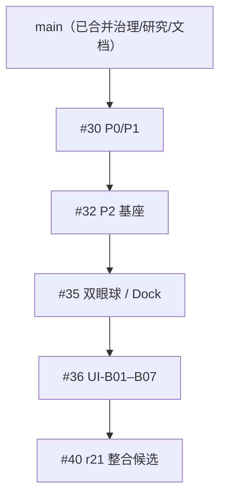

# Codex 从这里开始 · 2026-10-26 主仓库交接入口

> 2026-10-27候选增量：r22真实复制失败/重试、零架新建、整架/单项恢复、失效引用返回及正常重启已有精确原生子集证据；P2总关卡仍PARTIAL。见[恢复验收](research/P2-closeout-evidence/r22-recovery-native.json)与[失败反馈修复](research/P2-closeout-evidence/r22-copy-feedback.json)。下方r21快照为历史，开工仍需实时核查PR40。

> 此页是**导航与核查步骤**，不是持续自动刷新的 HEAD。任何旧 SHA 只用于证据定位；先拉取实时远端状态，不能按日期文档臆测进度。
> 当前唯一主线：**P2 r21 集中验收及安全合并 → P3 LAN → P4 本地搜索/AI/插件/工作流**。不要重新开展大规模需求问卷或重造原有功能。

2026-10-26候选增量：#30最新main冲突已按六份治理文件解决（3651746），后续测试等待条件/CI预算修正见#30；#40的r21已完成引用/绑定Copy/中文编号/双项拖出/Space/默认打开/正常重启/改键与OS退出释放部分实测。程序已退出，原生总关卡仍PARTIAL；详细上限以原生矩阵和Issue31最新记录为准。旧CI失败/取消保留，不能只引用历史成功。用户已授权普通项目自主桌面测试，其他安全门槛不变。

## 第零步：读这些文件（按顺序）

1. `AGENTS.md`：工程与用户数据安全限制；**该文件可能仍在主线与候选分支有差异，先核对**。
2. [项目真实状态与图解](project-status.md)：`main`/候选代码、最新 r21、验收矩阵与 PR 依赖；读完仍要实时验证。
3. [P2→P3→P4 总交付合同](execution/P2-to-P3-P4-sequential-delivery-2026-10-26.md)：任务阶段、风险关卡和交付格式。
4. [43 项 V0.1 冻结决策](product-decisions.md) + [P4 独立 44 项](product/P4-confirmed-decisions-01-44-2026-10-26.md)。
5. [UI 设计唯一规范](../design.md) + [P3 免费轻量界面合同](design/P3-free-first-lean-ux-contract-2026-10-26.md)。
6. [待决策与待实测清单](open-decisions.md)：优先由测试解决 `E` 编号事项，仅在真需要产品取舍时沟通 `D` 编号事项。
7. [阶段路线图](roadmap.md)、[P3/P4 研究](research/P3-P4-open-source-reuse-2026-10-26.md)与 [Gate 0–4](execution/P3-P4-implementation-gates-2026-10-26.md)；Gemini 只读复核保持独立与零额外默认费用。

## 第一步：检查真实 GitHub 和 Windows 状态

严格核查：

- 主仓库：`2539426035852ningmao-cmyk/ningmao-file-workstation`，默认 `main` 分支保护。
- 当前实际堆叠（2026-10-26 快照）：

- 当时 #30 的文档冲突已在 `3389a8d` 修复；#30 开放且可合并（这**不是**合并批准）。#32/#35/#36/#40 为 Draft，主线尚无完整桌面工程。
- r21 程序源码 `76210933f97d9a00b5ed8a3f4f8cd3ee24d73748`；PR #40 最新 HEAD 当时 `f717b1a2ea58de8d16a259dcc6c67dc8dd2f5ad3`。在用户机器上若代码/包不同，重新报告实际状态。
- 当前最新 HEAD 的 [Desktop CI](https://github.com/2539426035852ningmao-cmyk/ningmao-file-workstation/actions/runs/40295641668) 与 [Preview CI](https://github.com/2539426035852ningmao-cmyk/ningmao-file-workstation/actions/runs/40295641558) 成功；99 浏览器、69 Rust。**Windows 原生 P2 总状态仍为 PARTIAL。**
- 读取 [精确 P2 原生矩阵](https://github.com/2539426035852ningmao-cmyk/ningmao-file-workstation/blob/feat/p2-management-flow/docs/research/P2-closeout-evidence/native-matrix.json) 和 [r21 会话](https://github.com/2539426035852ningmao-cmyk/ningmao-file-workstation/blob/feat/p2-management-flow/docs/research/P2-closeout-evidence/r21-native-session.json)。不要把 r19 的单项 PASS 继承到 r21。
- 先核对本地工作树 dirty、候选包 EXE/MSI 哈希、是否已有运行程序、保存的数据目录、合成/私人目录边界；不得强制关用户程序或覆盖数据库。

## 第二步：P2 待收束的准确清单

| 优先级 | 原生验收项 | 当前证据上限 |
|---|---|---|
| 必要 | 正常引用/绑定 Copy、同名保护、拖出与恢复、Space/默认打开 | 旧版部分 PASS，r21 未集中验 |
| 必要 | 软回收、Windows 实体回收、跨架引用失效、整架恢复、零架、schema2/WAL 旧数据兼容 | Rust 合成测试 PASS，最新版 UI 未验 |
| 必要 | 跨窗管理中心复制队列、实时进度、取消与准确终态 | CI PASS，新候选原生未验 |
| 必要 | 全局快捷键占用/改键保存/退出释放/重启、唤出纠偏 | 默认唤出/暂停/恢复原生 PASS，其余未验 |
| 必要 | 球/胶囊/轻预览、托盘、置顶非置顶、遮挡恢复、DPI/多屏 | r19 部分视觉专项 PASS，最新版其他项未验 |
| 发布前 | 安装/升级/卸载、Win10 真机、签名/发行安全与性能预算 | 尚无稳定 Release，不可伪造 |

**按「复现 → 最小修复 → 合成/自动测试 → 精确 Windows 包 → 原生验收 → 保护层 PR 按依赖合并」执行。** 新功能不能破坏来源保护、Copy、用户标签、冻结目标 Dock、schema2/WAL 或真实回收。

普通授权范围内按现有协作规定自主推进；涉及 R3 真实文件/数据迁移/正式关键代码合并/首次网络监听/收费等另经具体风险批准。用户授权主仓库文档和治理优化，**不等于永久开放所有系统高风险行为**。

## 第三步：P2 通过后才能转正式 P3/P4

**P3** 首发零新增柠猫中央服务器费用的 Windows LAN 双端安全传输。LocalSend Rust core/protocol 先做隔离技术探针；本地 loopback 是实验不是双机。用户批准首次真实监听/设备配对/防火墙与接收位置后，按官方 LocalSend↔柠猫、柠猫↔柠猫做 SHA256/冲突/断线/取消真机证据。

**P4** 四段真实闭环：`A` 已授权 SQLite 跨架中英文搜索 → `B` 图片相似与自愿本地模型 → `C` 官方只读元数据安全示范插件与插件生命周期 → `D` 受控跨插件工作流、任务恢复与资源调度。首版不强制模型/云/会员/API，不在小文件架上堆按钮。

## D-01 首发政策已确认（不要重复提问）

用户于 2026-10-26 明确选择 **A 分阶段发布**：[正式发布门槛与测试版约束](product/D01-windows-preview-release-policy-2026-10-26.md)。P2 核心安全与 Windows11 x64 原生通过后，才可以考虑明确标注「未签名、仅供测试」的 Preview；稳定发行另审计 Win10/Win11 已宣称兼容范围、安装/升级/卸载、数据恢复和签名策略。当前**未批准自动发布、改 GitHub Releases、付费签名或绕过 R3 合并**。D-02 P3 首版范围也已确认选择 A：单文件 + 多文件批量，目录递归后置；下一项仍需用户确认的是 D-03 搜索结果敏感正文与路径展示，见 [决策台](open-decisions.md)。

## D-02 P3 首版文件范围已确认

用户于 2026-10-26 确认 **A：先单文件 + 多文件批量，文件夹后续实现**。阅读 [D-02 正式产品合同](product/D02-p3-file-batch-first-scope-2026-10-26.md)；首版不开发完整文件夹递归上传、不保留目录树，不许隐式展开或扁平化发送目录。批次必须逐文件准确状态、哈希/冲突/取消安全，并经批准后做真实 LAN 双端验收。不要重新询问已确认的 D-02。

## D-03 P4 搜索结果隐私已确认（不要重新问）

2026-10-26 用户确认 **C：轻量结果 + 按需展开**。详见 [D-03 完整隐私合同](product/D03-p4-search-result-privacy-2026-10-26.md)：默认只展示文件名、类型、所属架、匹配状态；正文命中片段、完整路径只有用户主动展开并重新校验授权后才能读取和显示；撤权后清理敏感派生数据，通知/球/普通日志不可外泄。与现有 P4 44 项一致，**不默认开启 OCR/全盘索引/云端上传**。D-04「第三方原生可执行插件开放时机」是下一项待讨论选择。

## D-04 插件开放策略确认（已有 P4 决策，不重复提问）

用户于 2026-10-26 选择 **C：分阶段开放 + 原生高权限独立审核**；它是 [P4 第29/30/31/32/33/34/38/39项](product/P4-confirmed-decisions-01-44-2026-10-26.md) 的落实说明，不是第二套插件方案。依据 [D-04 安全开放合同](product/D04-native-plugin-staged-approval-2026-10-26.md)，先官方元数据示范和受限能力代理，再第三方受限接口；原生高权限必须通过独立 Windows 安全验证、审核和明确授权，不能自动提升。**不要把同类插件权限问题再问一轮；应主动比对历史决策、完成技术探针、真实验收。** 当前仍先收束 P2。

## DevLab-C 已确定：开发加速，不替代 P2 验收

用户于 2026-10-26 选择 **C：外部 Codex 控制器 + 软件开发版内部受限诊断接口**。先审计现有 Playwright mock Harness、Rust 安全测试、stage-acceptance fixture 与 CI 实测耗时（Ubuntu `playwright --with-deps` 系统依赖安装约11.7分钟，99浏览器测试约1.6分钟）；**先优化系统依赖准备及重复编译，再做受限场景 CLI，原生诊断最后独立验证**。不得为了 DevLab 改坏 P2、绕过安全 Gate、向 Release 暴露测试后门。完整证据、阶段和回滚规则见 [DevLab-C 执行合同](execution/DevLab-C-codex-automation-and-fast-ci-2026-10-26.md)。

## 第四步：每轮提交的工作报告（中文即可）

1. `repo / branch / PR / current HEAD / source SHA / EXE hash`；
2. 本轮可运行的真实功能与保留的旧行为；
3. `CI / Windows-native` 每项 PASS、FAIL、PARTIAL、NOT_TESTED，测试环境与准确证据；
4. 影响文件、SQLite、权限、网络、费用、第三方许可证的风险；
5. 回滚点和下一次最小闭环；
6. 若确实要用户决定或单独高风险授权，按 [待决策登记簿](open-decisions.md)一次只提一个最关键问题。

**历史档案**：M1 原始资料仍位于 [milestones/M1.md](milestones/M1.md) 与 [m1-execution-baseline.md](m1-execution-baseline.md)；旧 PR #9/#11/#13 已并入后续候选的祖先线，不要重开这些旧草稿当作新的主工程任务。

## #30 与新 main 的文档同步

本分支普通merge main fc8903d带入D-01～D-04与DevLab合同，六处冲突均为治理/状态/文档。保留最新main入口及历史工程链接，不改变P0/P1应用子树，不构成阶段合并批准。#40本轮新增原生证据以其native-session为准，不把主仓库历史快照当实时结果。

## 当前候选增量检查点（优先于上方旧快照）

应用仍为精确r21源7621093/EXEc119311a…8f76a，未重建MSI。本轮已完成选择器Copy/中文编号保护、来源与组拖出哈希、Space/Esc及默认打开、管理跨窗完成终态/组合搜索、改键/正常退出重启；受控Windows探针已检查占用冲突和退出释放。详见[最新原生记录](research/P2-closeout-evidence/r21-native-session.json)。原生进度取消/回收/入口及DPI多屏仍有缺项，不宣布P2放行。用户已解除普通测试窗口/输入禁令，基本回归优先自主自动化。

本次将修复后的#30祖先3651746和main fc8903d合同带入候选，无业务变更。下一闭环独立DLV-0/1验证环境提速，不新增Mock/数据库或提前开启DLV-3诊断、P3监听、P4模型。

历史视觉/回滚入口：[D-ORB实施](tasks/D-ORB-implementation.md)、[r16证据](research/dual-eye-orb-evidence/README.md)、[UI-B01～B07与r19专项](tasks/UI-B01-B07.md)。r19用户专项PASS仍仅归旧精确包，不替代r21完整原生关卡。
