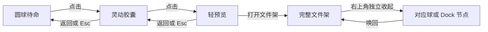

# 双眼灵动球 · Codex 开工前准备与验收矩阵

> 2026-10-25 · **准备清单，不代表功能实现/测试通过** · 对应 [视觉合同](dual-eye-orb-v1.md) · [Codex 交接](../handoff/CODEX-DUAL-EYE-ORB.md)

## 1. 当前仓库的已知工程背景（必须在执行当天重新核查）

- 根目录 `main`：研究基座与统一 `design.md`，**不是完整的当前桌面功能候选**。
- [PR #30](https://github.com/2539426035852ningmao-cmyk/ningmao-file-workstation/pull/30)：P0/P1 安全文件闭环候选，**open、未合并**；r10 对应精确 Windows 人工复测记录，只对那一份 EXE 有效。
- [PR #32](https://github.com/2539426035852ningmao-cmyk/ningmao-file-workstation/pull/32)：P2 桌面悬浮架、多个独立窗口、Dock、管理中心，**Draft，基于 PR #30 分支，不等于 main**。2026-10-24 的 r13 原生验收判定 **FAIL（Dock 两次投放未触发预期副本/任务）**，随后代码尝试修正窗口拖放事件并改善置顶勾选，但本轮查看的 HEAD 尚无精确对应新构建的原生成功证据。不得将这项标为 PASS。
- 已有 `apps/desktop/src/DesktopEntry.tsx`、`App.tsx`、`Manager.tsx`、`style.css`、`src-tauri/src/desktop_runtime.rs`、`shelf_windows.rs` 等候选实现；双眼原创形变和完整轻预览尚待实现。
- 必先读 `AGENTS.md`、`docs/codex-start-here.md`、`docs/product-decisions.md`、`docs/m1-execution-baseline.md`、`design.md`、`docs/roadmap.md`，实地确认当前 HEAD/CI、分支祖先、打开的 PR 和本机实际应用状态。

**原则**：本设计 PR 从 main 独立生成、**只含预研/文档/原创 SVG 参考**；交给 Codex 时需要将文档 cherry-pick/合并到以最新有效 P2 HEAD 为祖先的**独立 UI 功能分支**，而不是在 main 上重新实现 P2，也不是将视觉 PR 合并到错误代码基线。按 Git 实际祖先检查，不假设 PR 已合并。保持开发分支与安全回滚基线。

## 2. 现在就能提前准备、且基本无需动生产代码的工作

| 编号 | 可提前构建的成果 | 完成判定 |
|---|---|---|
| PRE-01 | 用户冻结决策、三色 Token、几何和文案表 | 设计合同可对照、无冲突 |
| PRE-02 | 状态迁移图与优先级、事件/取消规则 | [机器可读状态合同](orb-motion-contract.json) 可解析且关键转移无死角 |
| PRE-03 | 原创静态 SVG 三色球 + 形态参考 | [参考图](assets/dual-eye-orb-reference.svg) 能看出眼睛比例，无第三方数据 |
| PRE-04 | 测试用合成文件清单与路径边界 | 测试绝不依赖用户私有目录或真实素材 |
| PRE-05 | 现有源码/测试的接线图 | 标注视觉层 vs 原生拖放/Store/窗口权限的边界 |
| PRE-06 | 截图/录屏模板：光/暗 UI × 3 色皮肤 × 4 形态 | 每条证据注明提交/构建 SHA、OS/DPI、阶段 |
| PRE-07 | Dock 投放失败的修复复测方案 | r13 失败用例新候选**精确复测**，不继承旧 PASS |
| PRE-08 | 无障碍、兼容、性能与回滚门禁 | 指定脚本与人工步骤，失败可追溯 |

PRE 是准备项，不是宣称验证结果。原创参考素材只做造型指南，不能替代交互原型或 Windows 原生产品测试。

## 3. 交互状态机（不可只靠几个 CSS 类名硬切）

层次分离：
- `OrbAppearance`：皮肤；存储键/取值独立于应用深浅主题。
- `OrbPose`：`idle / gaze / blink / press / focus / working / success / error`，受优先级仲裁。
- `DesktopSurface`：`orb / capsule / quick-peek / shelf-open / dock / edge-handle`；真实可见性由 Rust/Tauri 窗口协调层拥有。
- `DragSession`：`none / entering / target-latched / committing / cancelled / completed`；由**原生事件 + 已冻结 shelf ID** 拥有。

用户可见的主路径：

关键仲裁：
- 原生拖放目标已锁定时，拒绝翻页、切架、移窗及可能改变命中区的动画；在 `drop/cancel` 后释放。
- `close/minimize` 不能等于 `quit` 或 `delete`；高风险异步操作正在执行要有正确保护。
- 用户高速连续点击、点击时切换文件架、拖放过程中切换主题、Esc 打断动画都必须落到**一个确定的状态**，不可打开两个冲突窗口。
- `prefers-reduced-motion` 与不可见/窗口被遮挡时，允许静态切换，无残留循环/假死。
- 球/胶囊的眼睛按皮肤选择对比色；完整窗眼睛按窗口表面可读性选择颜色；SVG 不应由于 DPI 造成模糊。

## 4. 自动化测试用例（先写失败断言，再实施）

### A. 视觉单元与交互组件（Playwright / React）
- **UI-01**：皮肤三选一且能独立持久化；应用深浅切换后所选球色不被覆盖。
- **UI-02**：`navy-black` 的 normal 状态无外描边、光晕、镜面高光/径向背景渐变；禁令可用样式断言 + 视觉验收。
- **UI-03**：独立 SVG 双眼保持 2 只、在各种小尺寸内不溢出；眨眼结束后回到正常眼睛形态。
- **UI-04**：单击 orb → capsule，单击 capsule → quick-peek，通过明确操作进入 shelf；Esc/返回按设计收回。
- **UI-05**：轻预览/完整架的左上角双眼**非 button、不接收键盘焦点、点击无业务副作用**；窗口标题和操作项可访问。
- **UI-06**：右上独立收起命令调用正确目标 shelf ID，不丢失内容/排序；禁用时可读提示。
- **UI-07**：快速连点、动画中切架、打开/收起竞态不产生双窗口或不可恢复状态。
- **UI-08**：深浅 UI × 三球皮肤下文本/缩略图可辨，窄窗 340×320 无横向溢出。
- **UI-09**：reduced motion 禁止不必要变形/眼睛追随；交互仍可完成。
- **UI-10**：单架/3 架/8 架及更多分组；左/右为竖排、上/下横排，已手动布置位置不被重写。
- **UI-11**：空架、长中文文件名、文件失效、活动复制、错误、离线目录均保持必要文字提示。
- **UI-12**：完整小窗只有单行主操作区，不因品牌眼睛新增第二常驻标题条。

### B. Rust / Tauri 控制与安全
- **NATIVE-01**：原生 `Enter/Over/Drop/Leave/Cancel` 只在最终 Drop 执行一次；不会 enter 时复制。
- **NATIVE-02**：文件拖放期间冻结目标架 ID；跨多个 Dock 节点移动时采用明确选择策略，最终确认目标一致且不误投到前一个架。
- **NATIVE-03**：拖放期间禁止重排/切页/关闭目标；解除后恢复操作。
- **NATIVE-04**：临时架只引用；绑定架执行 Copy 且同名编号；来源、原有目标哈希未变化。
- **NATIVE-05**：异常、离线、取消、重启、会话临时架生命周期符合既有基线；数据库完整。
- **NATIVE-06**：拆分→收起→Dock→唤回→合并，不出现幽灵窗/重复记录/误操作。
- **NATIVE-07**：完整窗右上收起映射到它自身 shelf ID，而非当前焦点中的其他架。
- **NATIVE-08**：WIN10/11、125%/150% DPI、双屏负坐标、断开显示器后的安全位置恢复。
- **NATIVE-09**：托盘、置顶、正常退出与未完成任务保护不回退。
- **NATIVE-10**：P2 r13 曾失败的 Dock 原生投放（至少重复两次，临时/绑定目标分别测试）在**修正后的精确 EXE** 上实际通过，保留错误/成功前后机器证据。

### C. 性能与无障碍
- **PERF-01**：隐藏/收起入口时停止非必要 `requestAnimationFrame` 和指针监听；卸载后不留计时器/监听泄漏。
- **PERF-02**：多架同时显示时只有活跃入口持续动画；连续开关/拖动不显著卡顿；记录基线与测量环境而不是拍脑袋声称“60FPS”。
- **A11Y-01**：收起、搜索、切架、取消与错误均可键盘访问；图标有 accessible name、焦点可见。
- **A11Y-02**：错误和复制/引用语义不只靠颜色或眼睛情绪。
- **A11Y-03**：球体皮肤选择和主题选择互相独立，任何组合都可读。

## 5. 合成测试夹具（实际生成测试文件时使用临时目录）

建议：`test-fixtures/orb-smoke/` 只放**自生成**、非私有的 PNG/JPEG/MP4 占位、中文.txt、English.txt、重复同名副本、长路径目录、一个故意失效引用、空架和包含空格/Unicode 文件名。若不易生成合法 MP4，用可识别假文件并清楚标记不能测试媒体播放。测试文件夹层级拷贝限制须按当前功能边界，不要将尚不支持的目录递归 Copy 当作可用能力。

建立 1/3/8 架的逻辑快照（包括持久引用、会话引用、绑定目录）及文件源/目标的 SHA256 清单。每条实机用例在前后留存：精确版本 SHA、测试设备/DPI、步骤、结果、源和目标校验、窗口/SQLite 快照、问题单。

**不复制用户实际资产，不上传私人数据库、系统路径、密钥或任何付费 API 凭据。**

## 6. 现有工具与建议检查命令（先确认运行环境）

依据现有 `apps/desktop/package.json`：`npm run build`、`npm run test:ui`、`npm run build:test`；Rust 在 `apps/desktop/src-tauri` 可运行 `cargo test`、`cargo fmt --check`、`cargo clippy -- -D warnings`（根据项目已固定特性、工作目录和当前 CI 命令校正）。根目录已有 `pwsh -NoProfile -File scripts/check-repository.ps1`。

先检查锁文件、依赖与脚本的实际状态，不因未安装依赖擅自污染仓库或报告 PASS。P2 详细 Windows 测试计划见 `docs/stages/P2-windows-acceptance.md`。

## 7. 退出条件与回滚

- **设计**：用户能实际预览三款皮肤×深浅 UI、确认眼睛/比例/动效，且所有必要状态没有丢失。
- **单元测试**：新增每一条交互规则都有明确断言，已有 P0/P1/P2 测试不退化。
- **原生测试**：Dock 投放必须在新候选精确 Windows 二进制中通过，否则整体验收 FAIL；不能只凭浏览器虚拟拖拽算通过。
- **安全**：不同类型文件架的引用/复制、来源保护和 SQLite 恢复通过真实目标哈希检查。
- **过程**：每次 PR 明确源码 SHA、测试 SHA、执行环境、失败/未测试；不自动合并到 main、不自动发行、不安装升级卸载、不擅自开启网络/付费模型。
- **回滚**：只回滚本次 UI 分支/提交与其配置变更，旧 r10/r13 候选、旧布局文件、原始数据库和所有源文件保留；视觉层回退不修改文件系统数据。

## 8. 当前不应提前消耗时间的工作

暂不增加 32 种复杂表情、粒子彩带、付费 AI 皮肤、复杂物理 3D、第二套 UI 框架、自动网络传输、插件商店、完整 AI 助手。先完成「**一个可用的球 → 胶囊 → 轻预览 → 完整架 → 正确收起**」和「**单架/多架原生文件投放安全**」两个最小纵向闭环。
