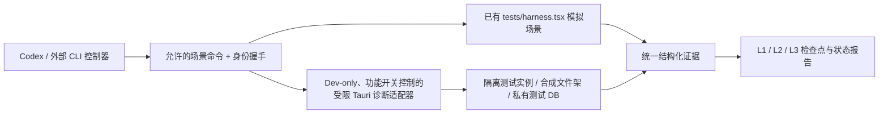

# DevLab-C · Codex 自主调试与渐进式检查加速合同

> **已选方向：C「外部 Codex 控制器 + 开发版内部受限诊断接口」**，2026-10-26 用户确认。用户希望优先复用成熟工具、缩短重复构建/测试等待、使用自动化场景与检查点，不为修一个局部功能反复从头测试。
> **状态：GitHub 代码/CI 已审计，实施方案已拟定；不是 DevLab 已写入程序或已完成提速的声明。** 只针对 `2539426035852ningmao-cmyk/ningmao-file-workstation`。P2 r21 原生验收与 R3 安全合并仍保持独立门槛。
> Codex 开工请先实时核实当前 PR、分支与提交，不假定本文快照 HEAD 是最新。

## 1. 证据：不是从零开发

审阅 `feat/p2-management-flow` 中：

| 当前实际设施 | 证据入口 | 应复用的部分 |
|---|---|---|
| 99 项 Playwright 测试，`workers:1` | `apps/desktop/playwright.config.ts`、`tests/browser/*.spec.ts` | 标签过滤与针对性执行；完整检查依旧保留 |
| 仅测试环境的模拟 Backend、场景、错误注入 | `apps/desktop/tests/harness.tsx` (`window.testHarness`, `fail`, `failNextSnapshot`, `notifyProgress`, `nativeDrag` 等) | 统一结构化场景 API，不建立第二套 mock；此环境不是 Windows 原生证明 |
| 独立合成目录与源文件哈希校验 | `scripts/stage-acceptance.ps1` 的 Prepare / Verify / 明确批准后的 Launch | 统一 fixture 根、数据目录与源文件保护；不使用私人文件 |
| Rust 文件安全、回收、窗口位置、进程中断测试 | `apps/desktop/src-tauri/tests/*` | 保留危险改动即时安全检查，不以 UI mock 代替 |
| 完整 Windows EXE / MSI / 许可/证据检查 | `scripts/build-desktop.ps1`、`scripts/build-preview-package.ps1` | 保留发布级检查，开发小改动不必每次打包 |
| GitHub CI 框架 | `.github/workflows/desktop.yml` / `preview-package.yml` / `repository-checks.yml` | 添加选择性执行、可复用编译证据与防回退 Gate |

当前**没有发现统一的外部 Codex DevLab 控制器、完整生产级诊断 API 或能替代人工 Windows 多屏/DPI/拖放测试的自动化**。必要时仍以精确 Windows 实机为准。

## 2. 准确的 CI 耗时基线，先治最大瓶颈

参考 [Desktop CI #40295641668](https://github.com/2539426035852ningmao-cmyk/ningmao-file-workstation/actions/runs/40295641668)、[Preview CI #40295641558](https://github.com/2539426035852ningmao-cmyk/ningmao-file-workstation/actions/runs/40295641558) 的真实步骤日志：

- Desktop browser 工作流约 **13分45秒**；其中 `playwright install --with-deps chromium` 触发 Ubuntu apt/系统库安装约 **11分43秒**，Chromium 下载约十几秒，**99 项浏览器测试仅 1分36秒**。不可误判“99 项测试导致 14 分钟”；`workers:1` 是次要优化方向。
- Desktop Windows 安全构建步骤约 **4分08秒**。
- Preview 的 Windows 流程再次执行 `build-desktop.ps1 -Native` 约 **4分41秒**，再运行实际 MSI 打包/校验约 **36秒**。独立 Runner 中存在重复编译与验证；两条工作流并行，节省其一不一定直接缩短全局墙钟时间。
- `scripts/build-desktop.ps1` 每次先运行 `npm ci`、`npm run build`；Browser 分支再 `build:test`、安装 Chromium 和全 Playwright；Native 分支跑 stage-acceptance test、Cargo fmt/test/clippy、Tauri build `--debug --no-bundle`。目前 workflow 明确 `setup-node` npm cache，但**没有看到独立 Rust target/cache 的专用配置**。缓存命中率与成本需要测量，不预先声称有效。

**优先顺序：Apt 系统依赖环境 → 局部测试不再重复装 npm / build → Windows Rust/编译缓存 → 判断 MSI 可否复用精确构建产物 → 最后试适度并行 Playwright。**

可对比依赖预装的受控 Runner 与 Playwright 官方容器/镜像方案；要求镜像与锁定浏览器版本对应、来源审查、GH-hosted 兼容及回退。保留原 `--with-deps` 路径为可用 fallback，严禁简单删掉系统依赖检查。Rust 缓存先调查 `Swatinem/rust-cache` 等成熟动作的固定 SHA、依赖许可证、缓存污染风险与跨作业共享稳定性。

## 3. 三层检查点（约束：不跳过真正危险的门槛）

### L1 快速内环：每次小改后，尽量不制作 MSI

- UI：TypeScript/受影响 Playwright spec、必要的窄窗交互/视觉检查；复用既有 dist-test/harness，不能为单个 React 文件重装整套操作系统依赖。
- Rust：`cargo check --locked`、受影响的 `cargo test --locked ... [filter]`；原生文件 Copy/回收/schema/权限改动自动追加指定安全测试。
- 每个检查输出 PASS/FAIL、耗时、源码 SHA、受影响模块与原始命令；测试失败不偷改标记、不用无条件 retry 伪造通过。
- L1 是开发反馈，不赋予 PR 合并/正式发行批准。

### L2 模块闭环：完成一个独立行为后的自动验收

- DevLab 控制器在**独立合成测试目录**创建 fixture → 运行既有 Harness/前端自动测试 → 收集结构化事件、截图、trace 与错误 → 校验源文件 SHA256/旧数据库一致性（适用场景）。
- Windows 原生只有在受控沙箱、明确目标候选 EXE 与安全门槛下才运行；优先试验官方 Tauri 推荐的 WebdriverIO `@wdio/tauri-service`，**但需隔离审查其额外后端服务/Dev-only 编译功能**；Windows WebView DOM 自动化不代替 OS 原生拖放、DPI、Shell 回收、分屏热插拔。
- 除确定的高风险覆盖项，不重复执行无关功能的全部验收；自动保留精确证据。

### L3 阶段全量/高风险 Gate：不能削减

- 每个重要 PR 合并前按照仓库规则做完整/必要 Repository checks、Windows 文件安全/回收/schema/窗口/任务检查、许可证/包体校验；正式候选与 Release 前运行完整回归 + Windows 真机验收。
- 高风险改动（真实写盘/回收、数据库版本、权限隔离、原生插件、网络/付费）即使只修改一行代码，也立即执行相应安全测试；不能利用“只跑受影响 spec”规避。
- 保留精确源码/构建 SHA、EXE/MSI hash、环境版本和风险/回滚记录。模拟 `PASS` 与 Windows native `PASS` 是不同证据，绝不能互相继承。

## 4. DevLab-C 安全架构（先 CLI，再可视化）



- **内部调试接口不得进入 Release 构建**：需独立编译时开关（例如 Cargo devlab feature；名字在实现前以实际工程适配为准）+ 显式测试启动参数 + 独立数据目录 + 短期会话认证；正式版没有注册对应危险命令。仅靠 UI 隐藏、仅靠环境变量或 localhost URL 不构成隔离。
- 优先本机受访问控制的进程间通信（例如 Windows Named Pipe / 明确用户 ACL），不开放 0.0.0.0 网络监听，也不允许通用任意 JSON shell / 任意 SQL / 任意文件路径写入 / 全局鼠标键盘钩子。
- 命令只允许**白名单场景**：读取状态快照、打开/收起指定自有测试窗口、注入合成文件、模拟特定失败、设置测试窗口参数、停止本进程创建的测试实例；每种命令校验目标窗口/进程/路径是否属于本次 fixture。
- 只运行当前控制器创建的测试实例；不得擅自关闭其他工作站、全局进程、篡改个人项目文件或 SQLite；不能改显示设置、全局快捷键登记（原生专项测试例外且需安全恢复）。
- 对于无法可靠隔离的原生行为，只报告 NOT_TESTED 并安排后续人工验证；不能伪装成已经自动运行。
- 可视化面板置于最后阶段，只读取诊断报告和显示状态，不以做漂亮控制 UI 代替已可运行的 CLI 自动化。

## 5. 4 个可回滚交付切片（不能替代 P2 主线）

| 切片 | 允许修改 | 必须交付的证明 | 回滚 |
|---|---|---|---|
| DLV-0 · 基线审计（无业务代码） | 日志/报告/隔离评估/新的运行耗时记录 | 当前/候选与优化前各步骤耗时、99 UI/69 Rust/安全检查不退化 | 删除工具实验分支与报告，不影响主程序 |
| DLV-1 · CI 先提速 | 独立工作流/脚本或最小差异，保持 fallback | 证明系统依赖安装耗时下降、所有 99 UI 与必要 Rust/CI PASS、构建/许可不缺项；失败自动使用旧路线 | 还原 workflow/脚本，不动 SQLite |
| DLV-2 · 最小外部 CLI | 在 `tools/devlab` 或现有 `scripts` 中复用 Harness、stage fixture | 单命令运行例如 orb→capsule→peek、文件架多选/复制失败、回收/恢复等合成场景，JSON + trace/截图 + 哈希守护；可重复运行 | 仅删除/关闭 DevLab 工具，应用候选不变 |
| DLV-3 · 受限原生诊断（独立高风险复核） | Dev-only feature + 实机 WebDriverIO/OS 自动化小切片 | 真正 Windows 原生启动/窗口状态/任务行为逐场景自动证据；Release 不含诊断命令，fixture 外读写和任意路径/命令不可达；不影响 r21 稳定候选 | 禁用 feature / 回滚独立诊断 PR，保留 P2 原始可运行包 |

若 DLV-1 在当前 runner 上未能实测获益，不为追求理论速度继续复杂改造；先修测量方法或切换备选。每个切片独立 PR，回归及失败可回退，**不得将高风险 P2 堆叠 PR #30→#32→#35→#36→#40 的合并作为 DevLab PR 的副作用**。

## 6. 复用现有工具规则

1. 先搜索既有 `window.testHarness`、Rust Store、Job/事件与 fixture，避免另建平行 Mock。
2. 对 Tauri E2E 优先评估官方推荐的 [WebdriverIO Tauri service](https://v2.tauri.app/develop/tests/webdriver/)；核查新版文档、Windows/Edge WebView 兼容和依赖增量。
3. 浏览器 CI 可按 [Playwright CI 指南](https://playwright.dev/docs/ci)评估预装依赖/官方镜像，且 CI 单 Worker 当前仅耗 1.6 分，不能误把主要瓶颈当作 Playwright 并行问题。
4. Rust 缓存优先评估 [rust-cache](https://github.com/Swatinem/rust-cache) 等成熟实现；固定审阅过的 action SHA 与可信来源，不直接复制动态 `@main` 或未经审查的第三方 Action。
5. 严禁复制商业软件专有实现或未授权资源；优先挑成熟合法开源组件小范围探针。

## 6A. 与未来 P4 AI/多模态 Agent 的复用关系（仅研究）

在维护现有 DevLab-C 优先级的前提下，另有 [DevLab-P4 统一能力边界研究](../research/DevLab-P4-unified-capability-boundary-2026-10-26.md)：已核查 `Backend`、Rust `Store`、`management_snapshot`、`snapshot_scoped`、复制任务与窗口权限，建议未来通过最小 DTO/主体授权/任务适配层复用，而**不是直接让 AI Agent 访问现有带完整路径的前端 Snapshot、共享测试命令或复用本地开发权限**。四组模拟场景为元数据越权、重复引用身份、任务异常/重复事件、用户标签确认与撤权。**还未实现或测试，不能冒称已通过。** 当前第一优先仍是 CI 环境安装与 P2 安全收束，不因多模态远景改变 DLV-0～3 顺序。

## 7. 最终 Codex 回报格式

每一轮只需：

- **基线**：仓库/分支/精确 SHA/系统和候选版本；
- **耗时差异**：修改前后 CI/本地 L1-L3 时长，并标注测量重复次数/机器差异；
- **复用**：有哪些现有脚本/模块被复用，新增了哪些小模块，为什么必要；
- **检查**：完整安全门槛、未测 Native 项、是否可重复；
- **证据**：Trace/截图/日志路径、关键 SHA、Hash、敏感路径脱敏；
- **回滚点**：如何一键禁用或回到之前的脚本/候选；
- **下一闭环**：优先降低用户感知等待时间，别为了 DevLab 引入新的复杂 UI 或强制安装。

**最终守则：DevLab 是加速已有研发循环的辅助设施，不是替代 P2 安全验收的新产品，不是让 Codex 拿到无限权限，更不是把调试后门留在正式版。**

## 8. DLV-2 第一切片：复用浏览器场景（不含原生诊断）

在已安装主工程开发依赖和 Chromium 的环境，从仓库根目录执行：

```text
node tools/devlab/run.mjs selection
node tools/devlab/run.mjs orb
node tools/devlab/run.mjs management
```

这是三个独立命令，按需运行当前受影响模块；分别复用既有 6 项多选、18 项球体/Dock、14 项管理测试。球体数量包含方向/多架参数化用例，以 Playwright --list 核查，不能只数顶层 test 调用。控制器不安装依赖、不重建 Mock、不改生产代码/SQLite/权限，不制作 MSI；类型检查和测试前端构建沿用原 build:test 的两步，一次约几秒。

每次建立新的、Git 忽略的 work/devlab 子目录，启动既有本机 loopback 测试服务与无头 Chromium。Playwright 新 Context 提供隔离 localStorage，所有素材仍是 Harness 的 SYNTHETIC 虚拟路径。输出 report.json、results.json、run.log 及每项 trace.zip；trace 内含截图/DOM 记录。报告绑定 HEAD、dirty 标记、Node/Playwright、受测源码与 Harness 的前后 SHA256 聚合指纹、各步骤时长和精确范围；有失败、跳过、flaky、数量不符或运行中源码变化均不能报告 PASS。

**证据上限是 BROWSER_SYNTHETIC**：没有创建真正 Windows 工作站进程，没有调用真实文件 Copy/Shell，realFileHashProtection 为 NOT_EXERCISED，不能冒充原生拖放、真实文件哈希保护或 DLV-3 已交付。真实文件夹具/后端组合的已实现增量见下方2026-10-27第二切片，后续仍按安全规则复用 stage-acceptance；不为这一步新增原生后门、网络接口或 Agent 权限。

仅接受以上固定场景名，拒绝额外路径/命令参数；直接调用已有 Node 入口，不拼接 Shell。控制器守护测试验证“退出0但漏测/跳过/有错误”仍失败，以及未知输入在创建产物/启动工具前被拒绝。CI 仅跑这些控制器守护，完整应用 CI 继续由原工作流承担。原始 trace/log/result 留在本机（可能带本机路径），公开仅同步脱敏摘要。

DLV-1 官方容器实测同源码原路线151s、预装167s，各n=1，未获益所以不推广默认；DLV-2的收益是集中可复用证据，不承诺让不变的测试执行更快。回滚只删除 tools/devlab 与独立守护工作流，原 Harness、工作站及稳定候选不受影响。


### 2026-10-27 DLV-2 第二切片：真实合成文件与 Store

新增固定命令 `node tools/devlab/run.mjs native-fixture`，仅支持 Windows。它复用既有 `candidate_fixture::prepare_candidate_fixture`，不再建第二套文件/数据库实现。原测试在新的、此前不存在的子目录建立真实来源、引用和绑定目录，执行中文文件两次 Copy/自动编号、Store integrity check，再正常关闭 Store；控制器核验5个合成来源/副本的SHA256、中文和英文已知内容、PNG签名、目录/文件及标记非符号链接。原始SQLite/日志留在被忽略的 work/devlab，只公开相对文件名与哈希摘要。

只使用已安装且版本核对为1.99.1的Cargo与rustc；兼容本机 stable 别名指向1.99.1，先列出已安装工具链再选择，`rustup run`不安装新版本，Cargo使用`--offline --locked`和单编译任务。首次按字面1.99.1工具链名称尝试失败时已明确FAIL；核查发现本机实际安装的是stable别名，改为识别已安装别名并验证真实版本，无安装、升级或全局配置修改。本样本完整8.25秒（含复用编译缓存，n=1），不是普遍提速倍数承诺；浏览器路径的执行器改动后，6项选择回归重新通过。

此报告scope为`RUST_STORE_SYNTHETIC`，`native=NOT_TESTED`明确指未启动工作站GUI；真实文件保护只限该新夹具中的已知来源和两个编号副本，不能替代本轮单独记录的r21原生窗口测试，更不等于回收/取消/Dock系统投放全验收。未暴露任意SQL、Shell或外部路径参数；没有Tauri开发后门、网络服务或Release业务改动。Node守护检查新增“即使测试退出0，来源或编号副本被改也拒绝PASS”的真实磁盘检查，三项控制器测试通过。旧浏览器工具行为/原始证据保留；回滚只移除这一模式，r21包与用户数据无需回退。
