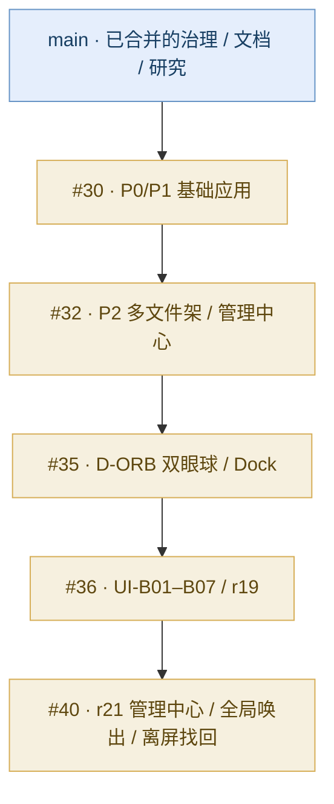
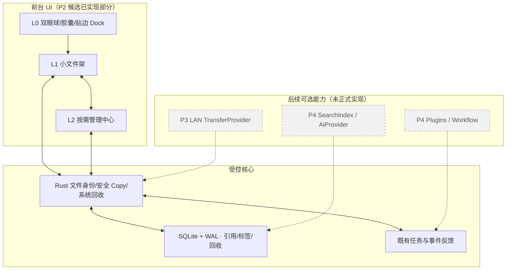

# 项目状态与功能总览

2026-11-09增量：唯一集成候选已推进到[#77](https://github.com/2539426035852ningmao-cmyk/ningmao-file-workstation/pull/77)，下方r7/#62保留为历史。当前[Android真实公网单向接收证据](research/P3-android-public-proof-20261109.md)已通过78B合成TXT浏览器接收/协议校验，发送verified、来源不变、服务清理完成；完整Windows公网UI、手机反向/大文件/另一Windows及正式发行仍未通过。最新精确SHA/CI和限制继续以[ACTIVE-DELIVERY](execution/ACTIVE-DELIVERY.md)为准。

核验日期：2026-11-05（香港时间）。本页负责功能/问题/分支关系；**唯一当前执行记录是[ACTIVE-DELIVERY](execution/ACTIVE-DELIVERY.md)**。本次仅同步文档，不改变功能审批、冻结需求或发布状态。

## 当前版本与代码关系

- 当前可试用：r7核心便携测试包；功能源码 `b960dcb2bb298557abb97029333ed91a698fd956`，候选记录HEAD `b3d0737918e42da005132371abb47ced3767d215`。
- 当前集成分支：`feat/p3-p4-consolidated-preview-20261105` / [PR #62](https://github.com/2539426035852ningmao-cmyk/ningmao-file-workstation/pull/62)。不要从旧r21文档重新造主工程。
- 本次核验main：`fc8903dc3a34a17707db3a9cbd12f631baaef71b`。main仍是治理/研究基线，完整桌面功能没有合入；无正式稳定Release。本地包不能当公网下载。
- r7实际启动/退出通过，128界面、102Rust通过/6明确跳过；服务真实专项另行执行1项通过。核验b3d0737的Desktop/Preview/P3三组CI均success，链接见仓库首页。CI不代替原生、双设备或真实模型验收。

| PR | 实时状态 | base → head / 职责 |
|---|---|---|
| #30 | open，非Draft，未合并 | main → integration/v0.1-p0-p1；P0/P1基础 |
| #32 | open，Draft，未合并 | #30 → feat/p2-desktop-loop；P2基座 |
| #35 | open，Draft，未合并 | #32 → feat/dual-eye-orb；双眼入口 |
| #36 | open，Draft，未合并 | #35 → feat/ui-b01-b07；界面修复 |
| #40 | open，Draft，未合并 | #36 → feat/p2-management-flow；P2收束，HEAD4034d785 |
| #57 | open，Draft，未合并 | #40 → feat/first-delivery-integration；首版LAN/AI，HEAD5c97a204 |
| #59 | open，Draft，未合并 | #57 → docs/p3-browser-companion-20261105；固定上游实验，HEAD5e197dd5 |
| #60 | open，Draft，未合并 | #57 → feat/capability-panels-polish；UI/r5，HEAD8a7068a6 |
| #61 | open，Draft，未合并 | #59 → feat/p3-browser-sender-adapter；分享进程/授权，HEAD1a09bde4 |
| #62 | open，Draft，未合并 | #61 → 集成分支，已本地带入#60；HEADb3d07379 |

这些PR核验时均无GitHub标记的合并冲突；不代表满足审批。后续合并前必须重新核查。不同分支中的同名文件不是可删除冗余。新文档同步PR基于main，不携带主程序代码、不改变上述依赖。

## 现有功能与验证范围

| 模块 | 已有能力 | 当前证据与未验边界 |
|---|---|---|
| 文件与数据 | 引用、绑定目录Copy、同名编号、来源保留、SQLite/WAL、软回收和系统回收 | Rust与合成文件测试/历史原生子集；r7全矩阵未重做 |
| 文件操作UI | Ctrl/Shift/框选、拖出复制、手柄排序、Space预览、系统打开、搜索/视图 | 自动回归及历次用户原生验收；不跨SHA继承全部PASS |
| 桌面与窗口 | 双眼球/胶囊/轻预览/Dock，多架拆合、置顶、布局、快捷键、托盘 | 有针对性原生证据；Win10、多DPI/多屏完整矩阵待做 |
| 管理与任务 | 元数据管理、任务状态/取消、回收记录、恢复 | 现有Store复用；不另建数据库 |
| 局域网 | IPv4/TLS指纹、逐批确认、1–16普通文件、暂存/校验/冲突编号/取消 | 真实回环和本机私有IPv4子集；双机及LocalSend未验 |
| 浏览器分享 | 固定croc适配、原生GUI/IPC、授权ID、真实下载/取消、任务持久化 | 4fd1e3d本机原生PASS；新增自动host单独PASS，组合原生待复测；r7不附组件/隐藏入口 |
| 搜索与整理 | 本地当前架/跨架检索、筛选、重复比较及规则建议 | 不默认全盘扫描；完整语义多模态/模型分析非已交付 |
| AI对话 | 服务配置、DPAPI密钥、多轮/流式/停止/历史 | 自动化/未配置原生子集；真实服务、额度/收费未验，默认不调用 |
| 插件/Agent/工作流 | 冻结设计、规则与基础能力逐步实现 | 不等于完整插件沙箱、商店、任意工具Agent或通用工作流已交付 |

## 已知问题与解决方向

| 优先级 | 类型与事实 | 方向 / 放行条件 |
|---|---|---|
| S1 | 浏览器组件依赖开发路径，尚未完整许可清关，故未进r7 | 锁定全部Go/web依赖与资产许可/署名，资源固定相对位置和hash，构建可移植组件包；清关前不分发 |
| S1 | 自动relay/web启动/退出已实测，尚未与新GUI组合原生复测 | 在同一固定源码上测创建→接收/取消→DB终态→退出/端口归零；不沿用旧手动host结论 |
| S1 | 两台Windows、LocalSend、手机/互联网均未验 | 先真实LAN双机，源/目标SHA、拒收/冲突/断线/取消；跨网另做HTTPS与部署门槛，不把localhost当公网 |
| S1 | 真实AI及计费配置未验 | 用户自行授权服务与密钥；费用明确后验证连续对话/停止/错误，不自动付费重试 |
| S1 | Win10、多DPI/多屏、安装升级/卸载与签名尚未完整验证 | 明确首版支持范围，补原生矩阵/数据备份恢复，保留未签名测试标识，不声明稳定发行 |
| S1 | 候选堆叠未合入main，首页和主工程不同步风险 | 统一此导航、ACTIVE与精确SHA；按真实依赖审核，未获明确批准不合并功能/发布 |
| S2 | 408条第三方清单仍1条既有精确版本映射警告 | 定位映射来源/版本并核验，不把自动清单当法律清关完成 |
| S2 | 原生观察更多菜单较长、常用与显示/排序混排 | 保留功能，先分组/渐进式入口及键盘可达性测试，小范围精简，不重设计 |
| S2 | 旧首页/产品页曾停在r21并把P3/P4仅写为计划 | 本次修正文档导航，旧证据归档保留，后续版本更新同一入口 |

以上是已观察的问题、交付缺口和验证不足，不是推测低概率竞态；本轮没有新证据证明S0文件安全缺陷，也不据此保证全面无缺陷。

## 下一步与回滚

先让用户使用[核心初版](first-preview-quickstart.md)，同时推进浏览器组件清关/资源分发与自动host原生组合验证，再做真实设备/模型验收。菜单精简跟随实际反馈。旧r6/r5独立保留；退出后备份data/webview，不互相覆盖数据库。所有产品决定和数据安全限制不变。

历史候选状态与原生证据（保留，不作为当前HEAD）

 > 2026-10-29 当前首版收束：用户明确本轮只交付 P0/P1/P2 日常闭环，暂停 P3/P4 扩展。已取得并核验 PR #40 的完整 Windows 程序包，启动与正常退出通过，核心文件流程尚未完整原生验收，不能称日用 MVP 已完成。见 [试用包及精确验收](stages/MVP-first-trial-20261029.md)。

# 项目状态与技术图解 · 唯一总览入口

> 2026-10-27候选增量：r22真实复制失败/重试、零架新建、整架/单项恢复、失效引用返回及正常重启已有精确原生子集证据；P2总关卡仍PARTIAL。见[恢复验收](research/P2-closeout-evidence/r22-recovery-native.json)与[失败反馈修复](research/P2-closeout-evidence/r22-copy-feedback.json)。下方r21快照为历史，开工仍需实时核查PR40。

> 当前候选增量：本轮r21已完成部分文件/管理/快捷键/重启原生闭环，详见[精确记录](research/P2-closeout-evidence/r21-native-session.json)；下方是main归档的历史核查快照，P2总体仍PARTIAL。

> **快照：2026-10-26 17:33 (Asia/Singapore) 前后的 GitHub 核查**；PR 状态可能继续变化。启动开发或执行合并时必须重新读取远端 HEAD、PR 和 CI；本页**不是自动更新的实时仪表盘**。
>
> 严格区分五种状态：`PLAN` 仅规划；`CODE` 功能候选代码；`CI_PASS` 自动验证通过；`NATIVE_PARTIAL` 有限 Windows 实机验证；`RELEASED` 正式发布。任何一个状态不自动代表下一个状态。

## 1. 当前究竟处于什么阶段

**P2 r21 收束 / 原生部分验收 / 功能尚未合并进 `main`。P3/P4 还没有正式产品能力交付。**

- [主分支](https://github.com/2539426035852ningmao-cmyk/ningmao-file-workstation/tree/main)：治理、M1-02/03 可复现研究、设计、文档、P3/P4 规划；没有已合并的完整桌面产品主工程。2026-10-26 审核时 `main` 为 `b57fdc3c2abb3e07b0133d2eb657e899d790fa7a`。
- [PR #30](https://github.com/2539426035852ningmao-cmyk/ningmao-file-workstation/pull/30)：P0/P1 候选，已修复与 main 的文档冲突，仍开放未合并。
- [PR #32](https://github.com/2539426035852ningmao-cmyk/ningmao-file-workstation/pull/32)：P2 多架/管理中心候选，Draft。
- [PR #35](https://github.com/2539426035852ningmao-cmyk/ningmao-file-workstation/pull/35)：D-ORB 双眼球与 Dock 候选，Draft。
- [PR #36](https://github.com/2539426035852ningmao-cmyk/ningmao-file-workstation/pull/36)：UI-B01–B07 / r19，局部 Windows 用户实测已通过，Draft。
- [PR #40](https://github.com/2539426035852ningmao-cmyk/ningmao-file-workstation/pull/40)：r21 最新综合候选（在 r20 管理流程基础上增加全局唤出和离屏找回），Draft，Windows 综合验收 `PARTIAL`。
- [PR #38/#39/#41](https://github.com/2539426035852ningmao-cmyk/ningmao-file-workstation/pull/41)：只合并了 P3/P4 研究、产品和执行合同，不代表网络或 AI 代码已实现。
- [Releases](https://github.com/2539426035852ningmao-cmyk/ningmao-file-workstation/releases)：核查时**无正式 Release**。

### 堆叠 PR 真实依赖关系

**合并原则：** 不能把末端 #40 当作不依赖前置的普通改动直接合入 main。先逐层查看 diff/冲突/审批/原生矩阵；main 集成包必须有独立验证。请勿因 `mergeable=true` 就自动宣布 R3 获批。

## 2. 功能实现矩阵

| 能力 | 开发实现证据 | 当前产品交付状态 / 边界 |
|---|---|---|
| 临时文件架引用、真实绑定架安全 Copy、同名自动编号、SQLite | #30 与历史原生 r10 实测 | **CODE + 部分原生实测**；未主线集成 |
| Ctrl/Shift/框选多选、拖出、Space 预览、双击默认程序、排序/筛选 | #30 和 r10 真实 Windows 抽样 | **CODE + 部分实测**；需在 r21 上完整回归 |
| 多架、Dock、悬浮/贴边入口、管理中心 | #32/#35 | **CODE + 部分实测**；跨屏布局完整验收未闭环 |
| 双眼球/胶囊/轻预览、拖动与圆角 | #36 r19 | **特定 r19 包用户专项 PASS**；不能继承给其他二进制 |
| UI-B01–B07、软回收/系统回收/整架恢复 | #36 后端与候选实现 | **CODE/CI**；最新 r21 UI 恢复/回收专项待测 |
| 组合搜索/跨窗 Copy 进度/取消反馈 | #40 r20/r21 | **CI_PASS**；最新候选真实跨窗任务待验 |
| Ctrl+Alt+Space 全局唤出、暂停、恢复 | #40 r21 | **NATIVE_PARTIAL**；基础唤出三项 PASS，冲突、重启、释放等待测 |
| 唤出纠偏/手动找回离屏窗 | #40 r21 | **CODE/几何测试**；完整多屏拔插未证明 |
| 局域网安全传输 | Issue #37 与研究文件 | **PLAN**；无正式 Windows 双机互传 |
| AI 相似图/语义搜索/模型下载 | P4 决策与研究 | **PLAN**；默认不联网、不下载 |
| 安全插件生命周期/跨插件工作流 | P4 第29–44项 | **PLAN**；未宣称已能安装第三方插件 |

## 3. 最新 r21 精确验证信息

- 当前 PR #40 HEAD：`f717b1a2ea58de8d16a259dcc6c67dc8dd2f5ad3`，其后端/前端程序源码与精确构建基线区分记录。
- r21 精确构建源码：`76210933f97d9a00b5ed8a3f4f8cd3ee24d73748`。
- r21 EXE SHA256：`c119311a50ff03cefe686a370602d994ba7a080c7de4ecdbb6b52f432178f76a`。
- r21 本地 99 浏览器 + 69 Rust 测试通过；另外两个历史受控入口维持 ignored，并有明确的 fixture 运行记录。
- r21 当前 HEAD 的 [Desktop CI](https://github.com/2539426035852ningmao-cmyk/ningmao-file-workstation/actions/runs/40295641668) 和 [Preview CI](https://github.com/2539426035852ningmao-cmyk/ningmao-file-workstation/actions/runs/40295641558) 均 SUCCESS；CI 不含完整人工 Windows DPI/多屏验收。
- Windows11 Home 中文版 10.0.22631：**原生 PASS** 仅包括管理中心打开、默认快捷键隐藏后唤出、暂停不唤出、恢复后再唤出。自动捕获 Space 预览时观察工具定位/最小化异常，**尚不能判断产品 Bug**。
- 真实磁盘 Copy/回收 UI、快捷键占用冲突、改键持久化、窗口遮挡/置顶、Win10/125%/150%/多屏均仍要在此精确候选版本验收。
- 合成数据安全记录 `schema 2`、`3 架 / 6 引用 / 0 任务 / 0 回收日志`、`integrity=ok`、保护文件未变；尚未完成所有异常场景。

权威详细证据：[r21 原生矩阵](https://github.com/2539426035852ningmao-cmyk/ningmao-file-workstation/blob/feat/p2-management-flow/docs/research/P2-closeout-evidence/native-matrix.json) · [r21 native session](https://github.com/2539426035852ningmao-cmyk/ningmao-file-workstation/blob/feat/p2-management-flow/docs/research/P2-closeout-evidence/r21-native-session.json) · [阶段收束](https://github.com/2539426035852ningmao-cmyk/ningmao-file-workstation/blob/feat/p2-management-flow/docs/stages/P2-closeout-20261026.md)。

## 4. 产品架构：现有与未来分清楚

箭头是目标边界**概念关系**，不表明每个同名 SDK 或模块当前都真实存在；Codex 应首先复用仓库已有的 Rust Store/任务和前端组件，不应照图重新建全套。

## 5. 后续顺序与阶段 Gate

| Gate | 可交付结果 | 必须仍然成立的保护 |
|---|---|---|
| **P2 收束** | 精确 r21 或后续最小修复版，Windows 原生安全/窗口/管理任务验收，分层 PR 正确合入 main | 原文件不动、schema2/WAL、同名副本、回收多引用、精确回滚 |
| **P3 隔离研究** | LocalSend 候选锁版本/许可；合成双进程本机安全试验 | 不默认开放 LAN 端口、不改主 Cargo.lock、不得冒充双机 |
| **P3 LAN 真机** | 官方 LocalSend ↔ 柠猫及柠猫 ↔ 柠猫双端受保护互传 | 首次监听/配对与权限需审批；身份、SHA256、非覆盖/断线安全 |
| **P4-A 本地搜索** | Ctrl+K 跨架中英文与标签/状态，索引可重建 | 只索引授权范围、不扫全盘、不损 schema2 |
| **P4-B AI** | 相似图片、可选本地模型、候选标签 | 下载/资源/许可需确认；默认不用云端或收费 API |
| **P4-C/D** | 官方安全示范插件与受控工作流、任务恢复 | 插件不继承权限、不自动修改或上传真实文件 |

整个项目目前没有正式 Release。每个交付候选应有 `source SHA`、`build SHA`、`EXE/MSI hash`、`CI 结果`、`NATIVE PASS/PARTIAL/FAIL/NOT_TESTED`、`风险`、`回滚` 七类证据。

## 6. 已确认与待确认

- **已确认、不再重问：** 43 项 V0.1 冻结决策、P4 独立 44 项、P3 免费/轻量界面职责、P2 已通过的视觉专项。见 [P4 44 项](product/P4-confirmed-decisions-01-44-2026-10-26.md)。
- **待原生证据决定，不用重新问产品：** r21 多屏/DPI、跨窗任务、回收及快捷键冲突；应先测试得出事实。
- **待技术探针，不用产品投票：** LocalSend Core 是否可直接复用、FTS5 中文短词效果、本地模型容量与插件沙箱可行性。
- **确实需要用户选择或风险授权：** 发布前兼容矩阵与签名成本策略、P3 首次真实 LAN 开端口/配对、P4 具体模型下载/云端出站/真实文件修改；见 [待决策清单](open-decisions.md)。

### D-01 · 首个对外测试版发布门槛（用户已确认 A）

2026-10-26 用户确认 **分阶段发布**：先在 P2 核心文件安全和目标环境 Windows 11 x64 原生测试满足门槛后，才考虑明确标注**未签名、仅供测试**的 Preview；正式稳定版仍要完成实际宣称支持平台的 Windows 兼容、安装/升级/卸载、数据备份恢复、DPI/多屏及签名信任策略审核。没有 Win10 原生证据不得声称支持已经验收。**本决定未批准现在发布任何包，也未批准 R3 合并**。

[完整发布门槛](product/D01-windows-preview-release-policy-2026-10-26.md) · [Issue #43](https://github.com/2539426035852ningmao-cmyk/ningmao-file-workstation/issues/43)

## 7. 图像证据使用规则

- [双眼入口样机概览 PNG](https://github.com/2539426035852ningmao-cmyk/ningmao-file-workstation/blob/97f779ee900ed10231a2ab18a562812afffcbd87/docs/research/dual-eye-orb-evidence/overview.png) 出自候选分支历史提交，**属于原型/浏览器证据，不是 r21 原生桌面截图**。
- 设计 SVG/布局示意也应标明是设计探索，不能在 README 中标注为“正式发布截图”。
- Windows 实际截图要保留精确包 SHA、系统版本、DPI、捕获方式和隐私脱敏说明；不要混用候选二进制的视觉验证。

