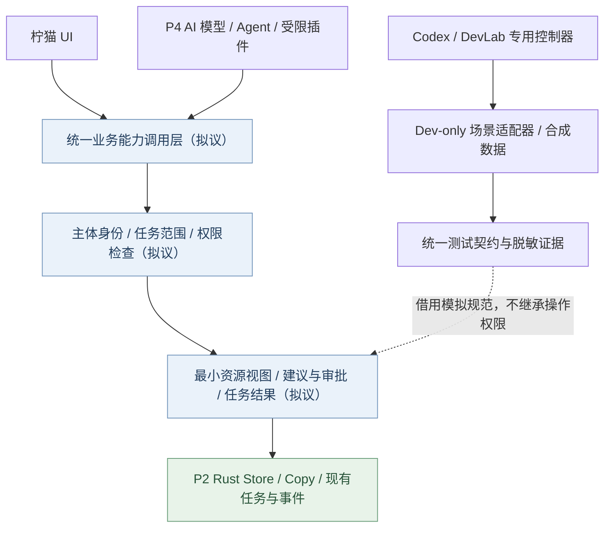

# 研究记录 · DevLab-C 与 P4 多模态/Agent 统一能力边界（第一轮）

> **研究日期：2026-10-26 · 状态：SOURCE-REVIEWED / PROPOSAL / NOT IMPLEMENTED。**
> 背景：用户已确认 DevLab-C「外部 Codex 控制器 + 开发版内部受限诊断接口」，并要求未来 P4 AI、多模态 Agent 尽可能复用同一套资源、任务与安全设施；希望研究与思考及时同步 GitHub。**此文不是新一轮选择题，也不是让 Codex 立即修改 P2 的交接提示词。**
>
> 对照的程序源码版本：PR #40 `feat/p2-management-flow` 的 HEAD `f717b1a2ea58de8d16a259dcc6c67dc8dd2f5ad3`；2026-10-26 核查时仍为 Draft、未合并主线，Windows 原生总矩阵 PARTIAL。基础文档见 [DevLab-C 实施合同](../execution/DevLab-C-codex-automation-and-fast-ci-2026-10-26.md)、[P4 原 44 项决定](../product/P4-confirmed-decisions-01-44-2026-10-26.md)、[D-03 搜索隐私](../product/D03-p4-search-result-privacy-2026-10-26.md)、[D-04 插件安全](../product/D04-native-plugin-staged-approval-2026-10-26.md)。
>
> 证据分三层：**已证实**=已读取具体 GitHub 源码；**研究建议**=合理的未来设计，尚未通过技术验证；**需实测**=不可凭代码阅读宣称可用。后续变更先检查新分支是否已不同，不用旧 SHA 冒充当前状态。

## 一、优先结论

1. **P2 底座应复用，不应重建**：`Store` 已实现引用、绑定架安全复制、标签事务、回收和已有复制任务；`Backend` 定义前端调用形状，`tests/harness.tsx` 提供可复用的合成模拟器。无需为了 Agent 引入第二套素材 DB、第二套复制队列。
2. **不能直接开放旧 UI API 给 Agent**：`ManagementSnapshot` 的 `items` 包含 `path`；普通 `snapshot_scoped` 在已绑定架第一层枚举并可能插入记录；现有窗口许可 `Scope::{Files,Metadata,...}` 判断的是窗口标签，不是可撤销的 Agent 身份。必须增加**明确的受控能力适配与最小 DTO**。
3. **引用 ID ≠ 物理文件身份 ≠ 内容重复**：P4 第07/09项要求区分“一个实体的多个引用、多个物理副本、完全重复/视觉近似”。`items.id` 只能先作为当前数据库里的引用标识；不应直接当跨设备、跨数据库或物理文件唯一 ID。
4. **P2 `jobs` 是复制日志，不是通用 AI 任务系统**。先在 DevLab 合成层试任务契约，真实持久化、队列调度和 schema 迁移留到 P4 的独立安全 Gate。
5. **DevLab 专权与真实 AI/插件权限分开**：共享资源/任务/权限概念及测试套件，**不共享故障注入、任意命令、真实文件操作或无限 Windows 控制权**。Release 应无开发专用调试入口。
6. MCP 和 A2A 只作为后续外部适配选项；**现在不强制引入 MCP 服务器、A2A、AI 框架、模型下载、局域网监听和付费 API**。

## 二、源码证据矩阵（截至上述 HEAD）

| 模块/证据 | 已证实 | 适配建议/限制 |
|---|---|---|
| [`src/backend.ts`](https://github.com/2539426035852ningmao-cmyk/ningmao-file-workstation/blob/f717b1a2ea58de8d16a259dcc6c67dc8dd2f5ad3/apps/desktop/src/backend.ts) | `Backend` 包含 `snapshot()`、`managementSnapshot()`、`tagReferences()`、`importPaths()`、`cancel()`、订阅复制进度等；`Item` 和 `ManagedReference` 暴露 `path` | 这是内部 UI API，不要原样外发给 Agent；定义最小只读 DTO |
| [`store.rs`](https://github.com/2539426035852ningmao-cmyk/ningmao-file-workstation/blob/f717b1a2ea58de8d16a259dcc6c67dc8dd2f5ad3/apps/desktop/src-tauri/src/store.rs) | `items`、`shelves`、`jobs`；`validate_item_scope` 和 `validate_job_scope`；`set_tags/tag_references`；`snapshot_scoped`、`management_snapshot` | 保留 P2 Schema2/WAL、用户成果和原复制逻辑，新增能力代理应独立做授权检查 |
| [`store.rs:745`](https://github.com/2539426035852ningmao-cmyk/ningmao-file-workstation/blob/f717b1a2ea58de8d16a259dcc6c67dc8dd2f5ad3/apps/desktop/src-tauri/src/store.rs#L745-L779) | `management_snapshot` 不枚举磁盘，但列出了已登记的 `path`，因此只读不代表不泄露隐私 | Agent 默认只返回名称、类型、所属架、状态等已授权必要字段；正文/路径按 D-03 用户主动展开 |
| [`store.rs:826`](https://github.com/2539426035852ningmao-cmyk/ningmao-file-workstation/blob/f717b1a2ea58de8d16a259dcc6c67dc8dd2f5ad3/apps/desktop/src-tauri/src/store.rs#L826-L934) | `snapshot_scoped` 对显式绑定根目录浅层读取并可能插入新记录 | Agent 获取“只读元数据”不可依赖该存在潜在索引更新副作用的接口 |
| [`store.rs:954`](https://github.com/2539426035852ningmao-cmyk/ningmao-file-workstation/blob/f717b1a2ea58de8d16a259dcc6c67dc8dd2f5ad3/apps/desktop/src-tauri/src/store.rs#L954-L1015) | `begin_job/stage_job/finish_job` 服务复制，状态含 queued/copying/terminal；`plan_copy` 明确仅复制文件不递归 | 通用任务状态可参考，但不要把 AI 任务写入既有复制表或冒充 P3 网络任务 |
| [`src-tauri/src/lib.rs`](https://github.com/2539426035852ningmao-cmyk/ningmao-file-workstation/blob/f717b1a2ea58de8d16a259dcc6c67dc8dd2f5ad3/apps/desktop/src-tauri/src/lib.rs) | 窗口 `main_only/metadata_scope/scoped_database` 和复制事件 `copy-progress/copy-finished`；复制 active 以 Mutex 管理 | 窗口标签≠Agent主体；P2 自身取消/进度不能直接承诺通用 Agent 重试与资源调度 |
| [`src-tauri/src/desktop.rs`](https://github.com/2539426035852ningmao-cmyk/ningmao-file-workstation/blob/f717b1a2ea58de8d16a259dcc6c67dc8dd2f5ad3/apps/desktop/src-tauri/src/desktop.rs#L74-L88) | `desktop::permits` 按 main/manager/desktop-entry 等窗口标签区分 Scope | 保留 P2 窗口边界，再由独立主体身份、任务与资源范围判定权限 |
| [`src-tauri/capabilities/default.json`](https://github.com/2539426035852ningmao-cmyk/ningmao-file-workstation/blob/f717b1a2ea58de8d16a259dcc6c67dc8dd2f5ad3/apps/desktop/src-tauri/capabilities/default.json) | Tauri `core:default` 能用于 main/manager/desktop-entry/shelf-* | 不等于任意插件/模型被 OS 沙箱隔离；原生危险命令仍需要 Rust 逐项检查 |
| [`tests/harness.tsx`](https://github.com/2539426035852ningmao-cmyk/ningmao-file-workstation/blob/f717b1a2ea58de8d16a259dcc6c67dc8dd2f5ad3/apps/desktop/tests/harness.tsx) | **独立测试构建入口**，`window.testHarness` 可以注入失败、失效素材、复制进度、取消、操作记录；依赖 localStorage 合成状态 | DevLab CLI 应**复用**其模拟能力，不能把浏览器 localStorage mock 当作真实系统权限证明 |
| [`management-center.spec.ts`](https://github.com/2539426035852ningmao-cmyk/ningmao-file-workstation/blob/f717b1a2ea58de8d16a259dcc6c67dc8dd2f5ad3/apps/desktop/tests/browser/management-center.spec.ts) | 已测试管理标签、进度、晚到事件、取消、查看筛选且保留来源 | 下一阶段可在合成环境增加 Agent 权限拒绝/确认/撤权场景，不能把旧测试冒充新增场景 PASS |
| [`management.rs`](https://github.com/2539426035852ningmao-cmyk/ningmao-file-workstation/blob/f717b1a2ea58de8d16a259dcc6c67dc8dd2f5ad3/apps/desktop/src-tauri/tests/management.rs) / [`process_safety.rs`](https://github.com/2539426035852ningmao-cmyk/ningmao-file-workstation/blob/f717b1a2ea58de8d16a259dcc6c67dc8dd2f5ad3/apps/desktop/src-tauri/tests/process_safety.rs) | 有标签事务、Windows 进程中断/路径权限/复制来源保护相关测试 | 保留作为真实安全 Gate，不以 Playwright 替代 Windows 文件系统验证 |

## 三、建议的最小可复用边界：四层，不是另一个大工程

- **层一：已有内核**。真正的文件记录、事务、绑定架 Copy、回收和已有任务仍归 P2 Rust 管理。
- **层二：新业务调用薄适配（建议）**。少量 capability ID、输入 schema、输出最小 DTO，不透传原始 `Backend`、路径或通用 invoke/SQL。
- **层三：主体身份/授权（建议）**。`caller_id` 不由来路不明的 Agent 自报即可相信；需宿主绑定已验证会话。每项许可必须约束 `action`、授权资源/架、期限、是否允许衍生数据、审批记录与撤销版本。授权要在最终读取/写入前再次检查。
- **层四：外部适配**。DevLab 合成调用器、未来 MCP server、Agent SDK、A2A bridge 是不同消费者，逐个以白名单授权，不直接分享测试命令。

## 四、拟议最小契约（**接口草案，非现有代码**）

| 操作类别 | 示意 capability | 默认可见/可做 | 必须拒绝或另行授权 |
|---|---|---|---|
| 获取文件架资源 | `asset.metadata.list` | 在明确已授权架中返回 `reference_handle、shelf_handle、name、kind、status` 等轻量字段 | 其他架、完整路径、正文、自动深度扫描 |
| 获取单项详情 | `asset.detail.read` | 当前有效授权内的额外元数据，返回最少所需字段 | 正文/完整路径须沿 D-03 再经主动展开和权限复核 |
| 发起模拟能力任务 | `capability.task.start` | DevLab 的合成 provider，可取消，有区分部分/失败的终态 | 真实付费调用、未经同意素材出站 |
| 查询/取消任务 | `capability.task.status/cancel` | 只读授权任务与取消请求的真实状态 | 查看其他调用者秘密、无权取消非所属任务 |
| 建议内部标签 | `tags.propose` | 返回 `proposal_id`、所涉引用及建议，不修改文件 | 自动写入真实文件、冒充确认 |
| 应用确认结果 | `tags.apply_approved` | 主程序实际记录了明确审批且范围仍有效后才执行内部标签变更 | 复用别人的审批、扩大范围、撤权后迟到写入 |

**隐私关键点：** `reference_handle` 应被当作受限资源引用而不是绝对路径/长期共享凭证；公开给 Agent 的 handle 不直接由可猜的裸 `items.id` 构成。其会话绑定/是否过期与重新定位由宿主决定，不允许调用者通过猜测 ID 跨架读取。

**身份关键点：** `reference_id` 可用于索引/定位**这条柠猫引用**；“同一真实文件”匹配应另有物理身份验证证据（例如系统文件 ID/卷 ID、可靠的路径解析和状态检查），并且处理硬链接、移动、重解析点、不可访问和版本变化。大小/修改时间/哈希可能辅助核对或判断内容重复，**不能单独充当授权依据或自动把不同物理副本合并**。先做合成矩阵，再决定 Windows 实现方式。

**任务关键点：** 复制队列当前服务 P2，暂不扩 schema。DevLab 先在内存或隔离 fixture 中验证标准任务状态 `queued/running/awaiting_approval/completed/partial/failed/cancelled/interrupted`；重试需明确 `operation_id` 和幂等判断，不能对文件写入、云上传、扣费或系统删除在中断后盲目自动重放。真实持久化与资源调度是 P4 41–42 项的阶段任务。

## 五、只需四组封闭模拟场景验证（不碰个人数据）

| 场景 | 合成输入与动作 | 预期 PASS / FAIL | 证据类型 |
|---|---|---|---|
| S1 · 最小读取与越权拒绝 | 两个文件架、不同素材；假 Agent A 只授权架 1；读取架 1 元数据 / 猜架 2 ID / 请求路径 | 架 1 最小 DTO PASS；架 2、正文、路径被拒绝；不产生隐式绑定目录索引副作用 | Harness 合成测试；Rust 实权验证后才叫 Native |
| S2 · 物理身份与引用区别 | 同一合成文件在两架引用、不同文件但同内容、文件失效/重新定位、符号链接或硬链接模拟 | 同一实体可聚合显示但可展开两个引用；真实副本不误合并；恢复不能丢用户标签；身份不确定时标记 unknown | 先确定性合成，Windows 文件身份独立实测 |
| S3 · 通用任务与失败 | 模拟模型 0 成本分析 3 张图片；运行、暂停/取消、超时、部分成功、重复事件与进程中断 | 任务状态不谎报全成功；晚到事件不复活已结束任务；`operation_id` 不导致危险重复执行；旧 P2 jobs 不受影响 | 模拟任务 + Rust 独立任务探针（以后） |
| S4 · 用户审核、撤权与异步竞态 | 提供三条标签建议，用户仅确认部分；处理中撤销一个架的权限；延迟返回含敏感正文的旧请求 | 未确认不能写；仅允许获授权引用的已确认内部标签；撤权后敏感结果不能再显示或提交；合法既有用户成果保留 | 合成场景 + 真正权限提供者的独立 Rust 测试（以后） |

**各场景额外必须检查**：与 `tests/harness.tsx` 测试构建相隔离、测试源 SHA256 未变、临时任务/数据可清理、退出或失败无后台 Agent 继续运行；记录精确 source SHA、scenario ID、最小脱敏输出、PASS/FAIL/NOT_TESTED。截图与 Chrome mock 不能被误当成 Win11 原生文件系统/权限的通过证据。

## 六、外部标准调研（只做适配，不当核心依赖）

| 技术 | 当前可提供的帮助 | 对柠猫的建议 |
|---|---|---|
| [Tauri 2 Capabilities](https://tauri.app/security/capabilities/) / [Scopes](https://tauri.app/security/scope/) | 能限制 WebView→IPC 暴露，但自定义 Rust 命令仍需审计作用域实现；原生 Rust 代码不受其约束 | 现有窗口限制继续保持，AI 使用单独能力审计；不能承诺“配置文件=OS 原生沙箱” |
| [MCP（2025-11-25 规范）](https://github.com/modelcontextprotocol/modelcontextprotocol/blob/main/docs/specification/2025-11-25/basic/index.mdx) | 对外标准化 tools/resources；HTTP 模式有相应授权规范，STDIO 不沿用 HTTP OAuth 流程 | **到需要外部 Agent 调用时**再适配有限白名单，不因 MCP 就打开公网/无限盘符或跳过每次工具授权 |
| [MCP HTTP 授权](https://github.com/modelcontextprotocol/modelcontextprotocol/blob/main/docs/specification/2025-11-25/basic/authorization.mdx) | 授权包括受众绑定和服务端 Token 验证 | 与 Windows 本地权限分离，不能把外部 Token 当成本机无限文件权限 |
| [A2A 规范（上游 1.0.0 文档）](https://github.com/a2aproject/A2A/blob/main/docs/specification.md) | 独立 Agent 的技能发现、任务与消息协调 | 等真正有跨 Agent/跨服务需求时再做 bridge；Agent 通信状态不自动等于具体文件授权/用户审批 |
| [DevLab-C 既有合同](../execution/DevLab-C-codex-automation-and-fast-ci-2026-10-26.md) | Codex 外部测试控制器、受限调试、L1/L2/L3、CI 提速 | 第一优先仍是 CI 环境准备瓶颈，不因未来 AI 扩展先写庞大新平台 |

**额外警示：** 来自文件内容、模型响应、MCP tool 输出、第三方插件元数据的指令都属于**不可信输入**。不能因为文本说“授权已完成”就改变能力许可；建议先在合成环境加入 prompt-injection、数据外传请求和跨插件权限冒用的拒绝测试。

## 七、建议的阶段顺序、证据与回滚

| 阶段 | 开展范围 | 验证前不得声称 |
|---|---|---|
| **研究阶段（本文件）** | 源码核对、风险与最小 DTO/任务契约、四组模拟场景设计 | 已实现 Agent 授权、已有模型工具链 |
| **DevLab DLV-1** | 先优化 CI 系统依赖安装与重复构建，保留原工作流回退 | 提速倍数未实测前不能承诺 |
| **DevLab DLV-2 小探针** | 复用原 Harness 的合成 scene runner，验证 S1/S3 的模拟版，独立报告 | 合成测试 ≠ Windows Native 权限证明 |
| **独立权限/资源探针** | 不改 P2 原有生产 API、sqlite schema2 的前提下，尝试 Rust 最小 DTO、安全 scope 与 S2/S4，使用专门合成 DB | 没有真实 Windows 安全证据不能宣布通过 |
| **P2 安全收束后、P4 实际阶段** | 依据已确认 44 项分段建设本地搜索、AI provider、受限插件和 Agent；再评估 MCP/A2A 适配 | 不得自动开启全盘/OCR/模型下载、出站上传和收费 API |

所有探针须独立 branch/PR，测试失败还原工具和适配器，不迁移/覆盖真实 SQLite，不改 P2 Copy/回收含义；完整 P2 r21 Windows 验收与合并流程依旧单独进行。**不需要用户再回答已经确定的 P4 选择题。**

## 八、审计结论与下一次研究问题

**架构上可复用**：现有文件架记录、引用 ID、标签事务、复制作业事件、浏览器合成 Harness；**必须新增或证实**：Agent 身份/授权撤销、最小资源 DTO、物理身份与引用关联、AI 类型任务契约、模型结果隔离、开发接口出 Release 的构建证明。

**目前不能断言**：哪种 Windows File ID 策略与硬链接/离线盘最相容，真正 Windows 撤权时延、哪种 Agent SDK 体积最低、MCP/A2A 哪个最先有真实业务价值。它们属于技术探针，不应再变成新的用户选择题。

下一次优先研究：**只读资源视图能否在不改变 `Store::snapshot_scoped` 行为的前提下实现**，以及**独立 AI/插件任务状态是否可通过 adapter 复用 P2 事件而不写入现有 jobs**。在未做真实模拟/Windows 测试前状态维持 PROPOSAL / NOT_TESTED。

**同步位置**：本文件属于仓库长期研究档案，追踪沿用 DevLab [Issue #49](https://github.com/2539426035852ningmao-cmyk/ningmao-file-workstation/issues/49) 与 P3/P4 [Issue #37](https://github.com/2539426035852ningmao-cmyk/ningmao-file-workstation/issues/37)，避免再建同义产品 Issue。
