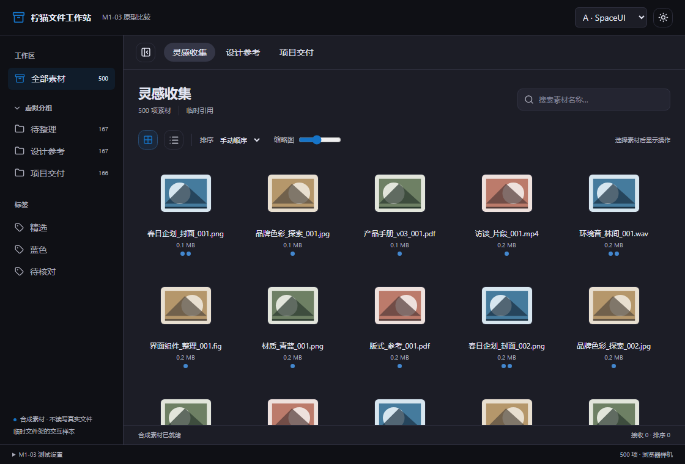
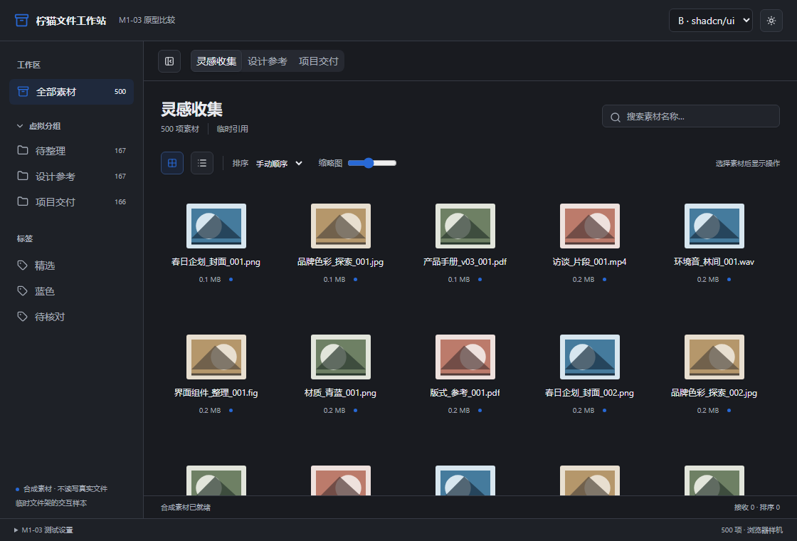
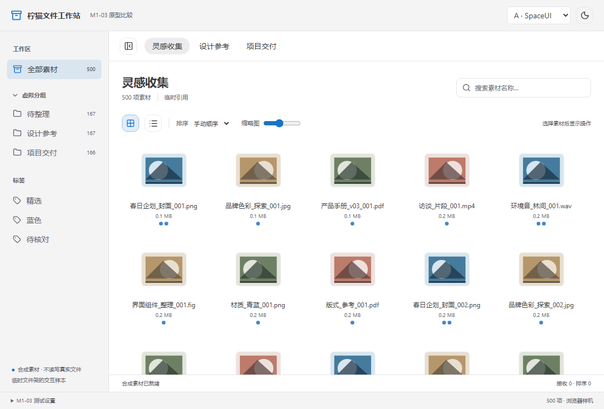
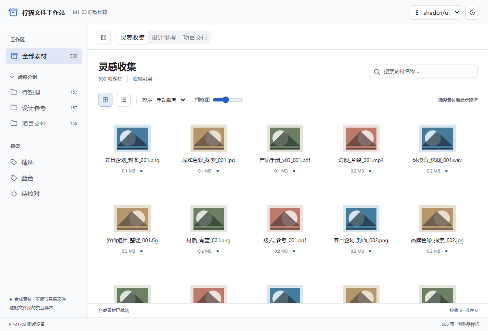
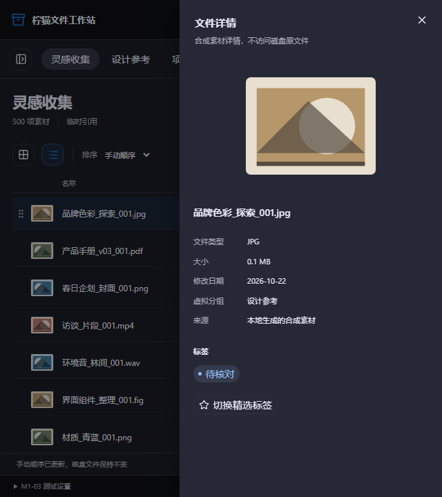
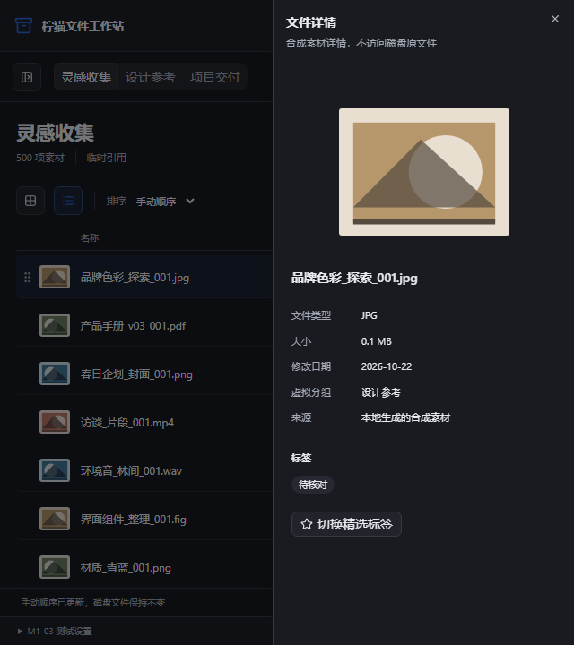

# M1-03 · SpaceUI 与 shadcn/ui 同功能比较

日期：2026-10-23（Asia/Hong_Kong）。用户已验收 M1-02 并授权继续。本轮为 UI 原型比较，不批准最终主视觉、主工程或正式文件功能。

## 可运行成果及建议

两套原型已使用实际开源组件实现，共用相同数据、结构、尺寸、虚拟列表和 pointer 排序。建议 **shadcn/ui 作为后续主设计系统候选，按许可选择性复用 SpaceUI 的文件专用组件**；该建议须经用户比较和 M1-04 批准，不能自动成为最终选择。

理由：两套在本轮功能上均可运行，SpaceUI 的 GridItem / FileThumb / TagPill 减少文件界面工作，但当前固定提交实际 Explorer 组件范围小于 README 所列清单，仍需大量宿主组合；其部分通用组件还耦合应用级表单/动画/管理器。shadcn/ui 的选定组件独立、改动面小，原型的 Sheet/ContextMenu/Tabs 能直接组合。此结论不是“SpaceUI 不维护”或“Radix 不可用”的概括，也不能仅凭单轮采样判性能胜负。

## 相同条件

| 维度 | 两套共同条件 |
|---|---|
| 尺寸 | 浏览器 1120×760；窄窗 640×720；Windows 默认客户区 1120×760 逻辑单位 |
| 信息结构 | 左导航、文件架标签、标题/搜索、渐进工具栏、内容、默认隐藏详情、底部测试设置 |
| 素材 | 同一确定性生成器，500/2000 项；中文名称、类型、日期、分组、标签、8 种合成 SVG 缩略图及一个不可用预览状态 |
| 基础能力 | React、TypeScript、Tailwind v4；两套均选 Radix 对应组件，避免同时比较不同底层交互模型 |
| 列表/排序 | TanStack Virtual 3.14.22；dnd-kit core 6.3.1 / sortable 10.0.0，PointerSensor + KeyboardSensor，统一碰撞策略 |
| 文件边界 | 样本只在内存变化；不读取用户目录、建数据库或删除磁盘实体。原生探针只允许拖出已知两份合成文本 |
| 主题/字体 | 均有深浅主题、蓝色强调、Windows 中文系统字体；没有远程字体或图片请求 |

对比入口在右上方，可切换方案；原生探针还可打开独立 B 窗。两套同编入一个研究可执行文件，因此**不能比较单独发行体积和冷启动开销**。不会把两套框架并行带入最终主工程。

## 源码与组件复用清单

| 候选 | 固定来源 | 实际复制及改动 |
|---|---|---|
| SpaceUI | [a48b1704](https://github.com/spacedriveapp/spaceui/tree/a48b17047d3ff1d05268acb6f88a79460ad4fa7b)，2026-04-14，MIT | Button、Input、Tabs、ContextMenu、Badge、GridItem、FileThumb、TagPill；theme/light token 共 10 文件。Tabs/ContextMenu 改 Radix 聚合包导入及旧 data-selector 写法，其余组件不改源码 |
| shadcn/ui | [3d98900e](https://github.com/shadcn-ui/ui/tree/3d98900e9b73c45f035f8109e9d41ba6a51685e7)，2026-10-22，MIT | new-york-v4 的 button、input、tabs、context-menu、sheet、badge 共 6 文件，不改组件源码；`cn` 解析到本地 clsx + tailwind-merge 组合 |
| 共享能力 | dnd-kit / TanStack Virtual / Lucide / Radix / Phosphor（原有 SpaceUI 组件内部图标） | 通过 npm 锁文件使用；不自行实现排序、虚拟化、焦点陷阱或 Windows COM/OLE |
| 原生探针 | 本仓 M1-02 的官方 Tauri 模板 + drag-rs 后端 | 修改 crate/应用/运行目录标识、窗口 URL 和尺寸；两个原生窗口均启用 Tauri 文件接收；不复制 Holdem 整个应用 |

原始 MIT 全文保存在 `experiments/m1-03/licenses/`。16 个文件的原始路径、固定 SHA、原始 SHA256、复制位置及改动见 [source-provenance.json](../../experiments/m1-03/source-provenance.json)。SpaceUI 的完整 Dialog 带应用级依赖，本轮未虚称复制它；窄窗抽屉以同一成熟 Radix Dialog 与 SpaceUI token 组合，shadcn 侧用其 Sheet。

SpaceUI 当前源码的 Explorer 实际为 GridItem、FileThumb、TagPill、RenameInput 等少量组件，README 中的 FileGrid/FileList/Inspector 等不能直接当成已提供能力。没有因此更换候选或复制 Spacedrive 整个产品。

## 功能与测试结果

| 功能 | SpaceUI | shadcn/ui | 证据范围 |
|---|---|---|---|
| 深浅主题 | 通过 | 通过 | 生产前端截图，保留各自组件语法和 token |
| 网格、列表、缩略图 | 通过 | 通过 | 相同素材；SpaceUI 使用真实 GridItem/FileThumb，shadcn 文件项由通用组件与宿主组合 |
| 文件架标签、分组、标签过滤、搜索 | 已实现；搜索/清筛验证通过 | 同左 | 组件真实交互，不做服务端或真实目录查询 |
| 渐进操作工具栏 | 通过 | 通过 | 无选中时收起操作，选中显示详情/预览 |
| 详情/预览/菜单 | 通过 | 通过 | 宽窗右面板、窄窗抽屉；Escape 关闭及焦点返回；右键更新样本标签 |
| 自适应导航 | 通过 | 通过 | 640px 自动收起，按钮重新展开与收回；不等于物理屏幕/DPI 实测 |
| Pointer 排序及中途反馈 | 浏览器通过 | 浏览器通过 | 保留中途浮层截图、最终顺序断言和计数；手柄命中使用 pointerWithin，键盘回退 closestCenter |
| 500/2000 项虚拟列表 | 通过有限 DOM 门槛 | 同左 | 两视图 8 组程序滚动数据，见下表；不把未测帧率写通过 |
| Windows 原生构建/启动 | 已构建并启动 | 同一可执行文件的 B 独立窗口 | 准确文件身份和原生交互结果另存证据；浏览器结果不替代原生测试 |

自动检查：1 个 Node 原生测试覆盖确定性素材、唯一 ID、过滤、保持源集合和安全重排；4 个 Playwright Test 用例覆盖两套交互与采样；Rust 素材防覆盖测试、fmt、Clippy `-D warnings`、Debug no-bundle 构建通过。使用独立官方 Playwright Test CLI；本机没有配置 Playwright MCP，不把两者混称。

本轮实际发现并修复：手柄位于卡片边缘时 closestCenter 产生目标偏移，改用成熟 pointerWithin/closestCenter 组合；虚拟列表滚动先前触发整个应用重渲染，已将虚拟化移到独立内容组件。最早开发模式/跟踪录制时的慢采样不混入下表。测试截图等待图像与过渡稳定，不把抽屉入场中途画面当最终状态。

## 视觉对照

以下全部为运行中原型的合成素材截图，没有生成界面概念图或虚构真实文件。

| | SpaceUI | shadcn/ui |
|---|---|---|
| 深色 |  |  |
| 浅色 |  |  |
| 窄窗详情 |  |  |

两套共享信息结构，视觉差异主要来自按钮/标签/菜单/抽屉、文件项和 token；不人为做两种完全不同布局影响公平性。SpaceUI 更接近其文件浏览器语法，shadcn 更适合按项目组件边界组合。最终偏好由用户判断。

## 500/2000 项实测采样

Windows 11、同机独立 Chromium 156 headless、生产前端预览、1120×760 CSS viewport、深色主题、单 worker。每组程序驱动 90 个 RAF 来回滚动，去掉最初 2 个帧间隔，剩余 88 个样本。没有同时运行本机原生编译；跟踪录制关闭。测试设置展开会占用相同可见高度。

| 方案 | 项数 | 视图 | p95 帧间隔 ms | 最大挂载文件项 |
|---|---:|---|---:|---:|
| SpaceUI | 500 | 网格 | 33.4 | 35 |
| SpaceUI | 500 | 列表 | 16.7 | 11 |
| SpaceUI | 2000 | 网格 | 33.4 | 35 |
| SpaceUI | 2000 | 列表 | 16.8 | 11 |
| shadcn/ui | 500 | 网格 | 16.8 | 35 |
| shadcn/ui | 500 | 列表 | 16.7 | 11 |
| shadcn/ui | 2000 | 网格 | 33.3 | 35 |
| shadcn/ui | 2000 | 列表 | 16.7 | 11 |

这些是已保存的一轮可复现实测；单次波动和两个文件项渲染负载不同，不能据此作显著性结论、人工输入延迟、WebView2 FPS 或 Release 性能承诺。后续准确候选回归另留记录，不挑最快值替换历史数据。DOM 门槛小于 160 项，实际最高 35，未一次渲染 2000 个文件项。

## 原生 Windows 与 M1-02 排序障碍

M1-02 中 Tauri 原生接收开启后 HTML DnD 未完成排序。本轮改为 dnd-kit PointerSensor，不设置 HTML draggable，继续使用原生接收，不为排序丢弃真实文件入口。当前原生程序 SHA256 为 `B4BE9CA17C264B6BB82BFD0FD327CC50362D785623566E177D15D759BF94D52D`，12248576 bytes；准确交互结果与限制以 `m1-03-evidence/native-verification.json` 为准。

自动 Windows 输入能触发 pointer 拖动开始，但释放时仍命中原项，因此不据自动输入把原生排序标通过；已请用户用实际鼠标核对 A/B。若没有对应回报和事件，不得把浏览器成功写成原生成功。本轮探针原生拖入仅记事件；M1-02 的实际拖入/安全拖出证据保留，本轮未实测的跨应用步骤不继承为新二进制已通过。

## 维护、许可和风险

直接复制来源均为 MIT，保留原文与修改记录；第三方库各自保留许可，主项目 Apache-2.0 不替代它们。npm 锁文件包含 190 个包记录（含可选平台包），已生成 license 元数据清单，初筛无缺失或 GPL/AGPL 标记；不是完整分发或漏洞审计。Cargo 依赖沿用 M1-02 锁定版本，仍需正式发行前补齐传递许可文本及 NOTICE。没有发布公共二进制 Release。

2025 年社区关于 Spacedrive 暂停、Radix 状态或 shadcn 迁移的反馈用于寻找线索，不能覆盖当前仓库事实。2026-10-23 API 核对 SpaceUI 为未归档 MIT 仓库，shadcn 固定源码仍有 Radix 组件；当前官方组件文档同时提供不同 primitive 入口。没有把社区“已弃用”的推测当成官方结论。主要原始来源：[SpaceUI](https://github.com/spacedriveapp/spaceui)、[shadcn](https://github.com/shadcn-ui/ui)、[迁移讨论](https://github.com/shadcn-ui/ui/discussions/9562)、[dnd-kit](https://github.com/clauderic/dnd-kit)、[TanStack Virtual](https://github.com/TanStack/virtual)、[当前 Button 文档](https://ui.shadcn.com/docs/components/button)。

## 交付与下一关卡

运行 `scripts/m1-03/build-ui.ps1 -Browser` 或 `-Native`；详情见 [样机 README](../../experiments/m1-03/ui-comparison/README.md)。CI 运行结果、最终提交及全部远程文件 SHA 核对回写 Issue #5 和 PR。main 保留既有保护，不绕过合并关卡。

Win10、其他 DPI、多物理显示器、跨架真实文件传递、正式目录/数据库、安全取消/冲突、大文件及完整键盘/屏幕阅读器审计没有在本轮完成。UI 样本不构成 M1-05 文件安全验收。用户验收 M1-03 后，再在 M1-04 审查已知风险并明确批准唯一主工程与视觉系统，本轮不自动批准。
