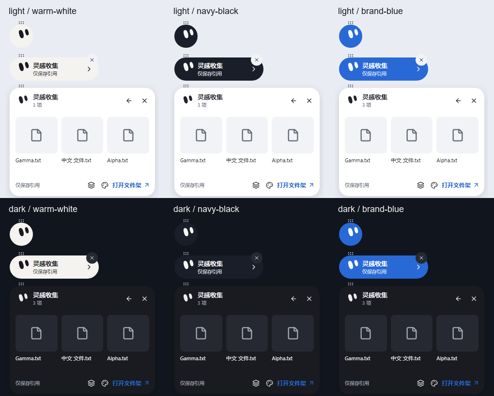

# D-ORB 候选验收证据

## 最新：r16 集中原生抽样已结束（2026-10-25）

修复源 **fdf71b9** / CI构建 **80a1efd**（完整tree相同），[精确r16核验](r16-verification.json)。80浏览器、36Rust、fmt/Clippy、Windows编译/MSI、双平台仓库检查通过；本机9文件/8哈希/PE/MSI核验通过。debug未签名，未安装、未合并、未发布。以下f7673e6与截图保留为r15精确历史，不能混用二进制身份。

本次Windows11真实抽样：完整架自身收起→圆球→胶囊→空/2条引用QuickPeek→明确打开完整架；r15两次固定绑定胶囊投放各得一份编号Copy/完成任务，r16再一份；副本与源一致，原目标及5保护对象未变。r15反馈截断被用户指出，新增断言先失败再修复，r16“复制完成”文字完整已由用户确认。记录见native-reference-drop及native-bound-drop文件。

r15正常退出→r16恢复5记录/2任务，完整性ok。r16移出目标取消前后6记录/3任务/4文件完全不变。用户随后另行试用过复制/排序、切浅色及调整尺寸，额外3任务/部分失效引用作为手动探索保留，不归因于取消。另取新基线9记录/6任务/5文件后，用户约3次右键取消，全部记录/任务/源与目标哈希不变：[右键取消证据](native-r16-right-click-cancel.json)。r16最终通过菜单正常退出、PID37788结束、记录/任务保持：[退出证据](native-r16-exit.json)。没有强杀，现恢复后台，不继续桌面输入。

### 右键取消的使用与边界

本机已验证：从资源管理器用左键拖文件到柠猫入口时，保持左键按住，轻点右键，再松开左键即可取消。复用现有Windows原生能力，无需额外全局鼠标监听。其他来源软件仍需分别验证。原生拖动继续/取消由来源实现决定，依据[Microsoft QueryContinueDrag](https://learn.microsoft.com/en-us/windows/win32/api/oleidl/nf-oleidl-idropsource-querycontinuedrag)；文档本身不证明所有来源都响应右键，本次结论来自实机前后快照。

**完整D-ORB/P2仍未验收。** 27项矩阵保留PARTIAL/NOT_TESTED，未把浏览器或本轮固定目标抽样当成全部原生PASS；多节点冻结矩形、隐藏细柄、独立拆合/托盘、整套P0/P1原生回归、Win10/150%/多屏、性能和最终产品视觉仍有门槛。没有新原生录屏，浏览器WebM始终标合成。

文档头99b69a2 CI出现一次旧排序菜单focus超时（78/79），未修改排序逻辑/测试或增加retry/skip；新功能源fdf71b9完整80通过。间歇失败记录保留于r16-verification，不称所有历史CI全绿。

---

实现源 `f7673e6b9065bfe0b6193247743bf660de5368bc`；实施 Draft PR #35，基线 P2 `63377ae`。设计源 PR #33 / `8b3ccb1`，不是合并或正式视觉批准。全套43项、原design.md与P0→P4路线保留。

## 已完成与证据类型

球→胶囊→轻预览→完整架→自身入口接通，三独立皮肤、双主题、横竖/自由Dock、1/3/8架、更多搜索、键盘快速打开、只读登记预览、按需RAF及低频眨眼。所有新眼睛曲线/引擎/状态独立实现，无受限角色或动画代码，无新增依赖。

[27项逐项矩阵](test-matrix.json)区分BROWSER_PASS/PARTIAL/NOT_TESTED，**没有宣称Windows原生已通过**。24形态PNG和3种架数量PNG由Playwright实际渲染；overview仅按原始尺寸排版，未重绘产品。深浅完整文件架见screenshots目录。环境为Windows本机无头Chromium，420×520 CSS viewport/deviceScaleFactor1；不是Windows原生窗口截图或DPI证明。

[捕获清单/哈希](captures.json)：两份WebM为真实浏览器录制，分别包含六种组合的转场与低频眨眼恢复，保存在本机D-ORB-r15-demo交付目录，不混入原生录像，也未上传私人桌面。代码测试捕获可用ORB_VIDEO=1和ORB_EVIDENCE输出目录复现，不需要操作桌面。

## 验证及失败记录

- 初始新增UI断言实际失败：没有胶囊和双眼。完成实现后最初64项完整通过。
- 44→48px顶栏使6个紧凑布局断言失败；产品恢复规范允许的44px，未删除旧检查。
- 扩展首轮73/74通过，断言仍在聚焦的QuickPeek中找已消失球体；改为明确返回胶囊再检查纯色，保留原样式/持久化断言。随后77项完整通过。
- 新增复制失败文字与真实低频眨眼恢复，共17项专项通过；精确源码云端完整79项通过。
- Rust36通过；另2个受控fixture入口按原设计ignored，不是新增跳过。fmt/Clippy通过。新增Rust接口首次缺失导致编译失败，只算接线红态，不算复现OS故障。
- 既有文件安全、复制编号、SQLite、Ctrl/Shift/框选/组Copy/Space/打开/排序/拆合测试保留。MSI只读检查及包身份另见候选verification.json。

## 严格门槛与集中原生步骤

旧r13 Dock失败保留；r14固定绑定入口约3次投放/3任务/3副本哈希一致、Esc零变化，仅是旧EXE部分证据，反馈不足仍FAIL R2。新入口改了矩形，不能继承。

新包先核对精确源码/构建/EXE哈希，以全新隔离合成目录启动，不复用私人数据库。集中顺序：

1. 正常恢复/退出旧r14（不强杀、不操作旧r10）后，验证球、胶囊、轻预览、明确全架及自身收起；快速键盘打开。
2. 引用架与绑定架分别至少2次单次OS拖放，记前后记录/任务/目标文件和哈希；检查可读反馈、一投放一次提交、同名编号且源不变。
3. 保持鼠标按住跨节点，确认目标/矩形不变，其他节点松开安全拒绝；Esc取消后所有数据不变。隐藏细柄和展开目标分别测。
4. 主/独立架Ctrl/Shift/框选/组拖出、Space/Esc/默认打开、排序/标签/拆合、置顶/X/托盘、正常退出重启；核对SQLite完整与v1/v2/v3原件。
5. Windows10/11、125/150%、多屏/负坐标/断屏、reduced-motion、CPU/GPU闲置及后台遮挡单列，未执行即NOT TESTED。

只有用户明确方便才进入桌面测试。用户已明确“现在方便，开始集中验收”；已实际启动精确r15，球/胶囊/空架QuickPeek/收回已观察，当前等第一次引用拖放。见[native-session](native-session.json)。尚未完成真实文件投放、退出重启和完整矩阵，没有安装MSI、合并或发布。最终视觉需用户确认；浏览器/单元/编译通过不替代原生安全门槛。

## 回滚

回到P2基线63377ae或保留r14包；保留DB/来源/所有候选及desktop-layout-v1/v2/v3/v4，旧程序读取旧版本。不删除、覆盖或降级用户数据。新文档不改变原design.md已验收内容，最终视觉后再增补。
