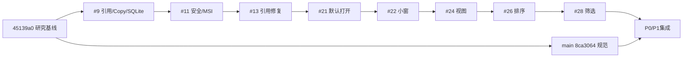

# P0/P1 受控集成基线

2026-10-24，Issue #29，[正式总执行指令](../execution/v0.1-p0-p4-2026-10-24.md)。没有正式稳定发行版。main规范基线8ca3064，统一开发入口integration/v0.1-p0-p1；精确head/CI/产物以阶段PR为准。

逐个merge-base验证所有功能head均为#28的祖先，无重复cherry-pick。#19为独立诊断文档，公开脱敏记录保留，非功能底座。

实时#9为draft=true/mergeable=false/dirty。merge-tree复现AGENTS.md、PRODUCT.md、README.md、docs/milestones/M1.md四份文档冲突，Rust/SQLite无合并冲突。main仍强制strict Windows/Ubuntu检查与管理员保护。

最新功能底座#28 6b66c52543857a12a1d8402da518e6383e664aab已包含#9至#28全部能力；07ca2736b7346994ac13d92bdc7969211ed7d243合入main规范，解决当前五份文档冲突，未改apps/scripts/licenses/权限。历史分支、提交与候选保留，不机械逐个合并。

## 本阶段完整链路

Explorer原生拖入 → 临时架引用/绑定目录Copy → SQLite与缩略图 → 选择/Space/默认打开/整理 → 原生Copy拖出 → 托盘隐藏/完整退出 → 重启恢复。

本阶段卡片鼠标移动6px后调用既有受ID约束的start_native_drag，六点手柄仍只排序，阻止HTML dragstart；取消/失效/请求失败保护，单击和双击保持。Rust仍为DragMode::Copy，不新增Move或任意路径权限；显式“拖出复制”继续作为降级入口。**自动请求契约通过不等于新EXE真实OLE拖放通过**，实际来源哈希和目标程序接收待验收。

正式配置420×520/最小340×320，preview移除重复windows数组直接继承。尺寸记忆复用官方tauri-plugin-window-state 2.5.0，仅SIZE，不恢复隐藏/全屏/置顶；无前端插件权限。完整退出保存尺寸，异常终止可能丢失最新尺寸，不影响SQLite。隔离数据根下尺寸文件同样隔离。

原34项浏览器保留，新增4项阶段检查与合成验收准备脚本；本机38项及生产构建通过，最终Windows/18项Rust/许可/包结果以阶段PR实际记录为准。回归先复现旧正式窗口1000×720及卡片无直接拖出请求。完整验收步骤见[集中清单](P0-P1-windows-acceptance.md)。

## 历史版本与回滚

| 候选 | manifest提交（CI临时合并） |
| --- | --- |
| r1 | ce1a947e18dafae2c524732080298564dac04179 |
| r2 | cdedc1bfa5abdfd037845316e2cc3faa97148fe6 |
| r3 | 15fd6cac2f85fd35bbaf03e324104edaf7921887 |
| r4 | b6ef5b7b24ef43e414fb51d43294deffe19bd2dd |
| r5 | 6be2d4a2b32087962765579e0712e79b1c773dc5 |
| r6 | 6df7813efa0cd60e4de95f1c8c7f78796e0bc7a4 |
| r7 | 178a587cf7ab86ecb4b10f2a157f1ec502087d5a |
| r8 | 72051e5237705df93a08faea4aedaf4fa733ca6b |

回退本阶段或回到#28/r8，无不可逆schema迁移，不删除SQLite、设置、profile、来源或暂存数据。窗口尺寸文件不在SQLite备份中；不是配置安全迁移。未签名debug候选非正式发行，已有依赖映射警告保留。

P2直接沿用当前Tauri/Store/窗口状态能力，做orb↔shelf、贴边、Dock及按需管理中心；不再造第二套文件存储。原生验收前可准备独立低风险代码，但对外监听、正式发布、文件安全合并和隐私AI各自保留授权门槛。Gemini #17不阻断产品，不标为双模型验证通过。
