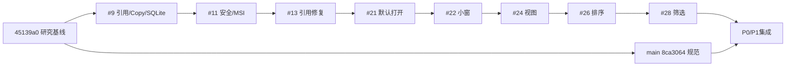

# P0/P1 受控集成基线

2026-10-24，Issue #29，[正式总执行指令](../execution/v0.1-p0-p4-2026-10-24.md)。没有正式稳定发行版。main规范基线8ca3064，统一开发入口integration/v0.1-p0-p1；精确head/CI/产物以阶段PR为准。

逐个merge-base验证所有功能head均为#28的祖先，无重复cherry-pick。#19为独立诊断文档，公开脱敏记录保留，非功能底座。

实时#9为draft=true/mergeable=false/dirty。merge-tree复现AGENTS.md、PRODUCT.md、README.md、docs/milestones/M1.md四份文档冲突，Rust/SQLite无合并冲突。main仍强制strict Windows/Ubuntu检查与管理员保护。

最新功能底座#28 6b66c52543857a12a1d8402da518e6383e664aab已包含#9至#28全部能力；07ca2736b7346994ac13d92bdc7969211ed7d243合入main规范，解决当前五份文档冲突，未改apps/scripts/licenses/权限。历史分支、提交与候选保留，不机械逐个合并。

## 本阶段完整链路

Explorer原生拖入 → 临时架引用/绑定目录Copy → SQLite与缩略图 → 选择/Space/默认打开/整理 → 原生Copy拖出 → 托盘隐藏/完整退出 → 重启恢复。

本阶段卡片鼠标移动6px后调用既有受ID约束的start_native_drag，六点手柄仍只排序，阻止HTML dragstart；取消/失效/请求失败保护，单击和双击保持。Rust仍为DragMode::Copy，不新增Move或任意路径权限；显式“拖出复制”继续作为降级入口。**自动请求契约通过不等于新EXE真实OLE拖放通过**，实际来源哈希和目标程序接收待验收。

正式配置420×520/最小340×320，preview移除重复windows数组直接继承。尺寸记忆复用官方tauri-plugin-window-state 2.5.0，仅SIZE，不恢复隐藏/全屏/置顶；无前端插件权限。完整退出保存尺寸，异常终止可能丢失最新尺寸，不影响SQLite。隔离数据根下尺寸文件同样隔离。

原34项浏览器保留，新增4项阶段检查与合成验收准备脚本；本机38项及生产构建通过，最终Windows/18项Rust/许可/包结果以阶段PR实际记录为准。回归先复现旧正式窗口1000×720及卡片无直接拖出请求。完整验收步骤见[集中清单](P0-P1-windows-acceptance.md)。

## 历史版本与回滚

| 候选 | manifest提交（CI临时合并） |
| --- | --- |
| r1 | ce1a947e18dafae2c524732080298564dac04179 |
| r2 | cdedc1bfa5abdfd037845316e2cc3faa97148fe6 |
| r3 | 15fd6cac2f85fd35bbaf03e324104edaf7921887 |
| r4 | b6ef5b7b24ef43e414fb51d43294deffe19bd2dd |
| r5 | 6be2d4a2b32087962765579e0712e79b1c773dc5 |
| r6 | 6df7813efa0cd60e4de95f1c8c7f78796e0bc7a4 |
| r7 | 178a587cf7ab86ecb4b10f2a157f1ec502087d5a |
| r8 | 72051e5237705df93a08faea4aedaf4fa733ca6b |

回退本阶段或回到#28/r8，无不可逆schema迁移，不删除SQLite、设置、profile、来源或暂存数据。窗口尺寸文件不在SQLite备份中；不是配置安全迁移。未签名debug候选非正式发行，已有依赖映射警告保留。

P2直接沿用当前Tauri/Store/窗口状态能力，做orb↔shelf、贴边、Dock及按需管理中心；不再造第二套文件存储。原生验收前可准备独立低风险代码，但对外监听、正式发布、文件安全合并和隐私AI各自保留授权门槛。Gemini #17不阻断产品，不标为双模型验证通过。

## 精确交付r9（2026-10-24）

当前审核入口[PR #30](https://github.com/2539426035852ningmao-cmyk/ningmao-file-workstation/pull/30)，关联Issue #29。功能提交1b15f7864c66324e85fd615dc008d3a14974a251；CI临时合并715f7d3ab1613e726f74b4080847e94a04af67d4，两个提交tree均为068ffb5b99222dc5e678c7b26df00aca4beca24c，完整文件树一致。后续阶段文档证据提交不改变该精确候选代码，不把新文档head冒充二进制构建提交。

| 云端流程 | 实际结果 |
| --- | --- |
| [Repository checks 40080072233](https://github.com/2539426035852ningmao-cmyk/ningmao-file-workstation/actions/runs/40080072233) | Windows/Ubuntu通过 |
| [Desktop 40080072232](https://github.com/2539426035852ningmao-cmyk/ningmao-file-workstation/actions/runs/40080072232) | 38浏览器、18Rust、fmt、Clippy -D warnings、原生编译和合成验收脚本通过 |
| [Preview 40080072249](https://github.com/2539426035852ningmao-cmyk/ningmao-file-workstation/actions/runs/40080072249) | 安全回归、MSI结构/许可/交付完整性及打包通过 |

两个Rust ignored入口是合成夹具准备与父测试实际调用的复制子进程入口，不作为18项通过计数。真实杀进程/SQLite、ACL、共享占用、Unicode长路径等既有安全测试保留；不代表断电/磁盘耗尽已实测。

产物12554024425，ZIP SHA256 733f88b0aabbce69d17e3fc4747cde4d808b5ded127588c439c5c6eb2667a38d，本机下载复核一致。包名M1-06-preview-package-r9，未覆盖旧r1–r8；9文件白名单、8个SHA256、PE32+x64、0.1.0、NotSigned、MSI表及嵌入载荷大小匹配、检查后字节不变均通过，见[包核验JSON](../research/P0-P1-stage-evidence/package-verification.json)与[源码身份](../research/P0-P1-stage-evidence/source-identity.json)。未提取CAB逐字节比较、未安装启动。

| 文件 | 字节数 | SHA256 |
| --- | ---: | --- |
| Ningmao-Preview-0.1.0-x64.exe | 17747456 | ec8ab94fe0b8052509fad354ed61a7078b5418f618d864bcedf11927060f0d3a |
| Ningmao-Preview-0.1.0-x64.msi | 6148096 | 35407ce5a24f04504a1190dea0c42b3f0454bf576e51c6def295e80343fec641 |

许可268条、缺原文0、精确源码映射警告1（既有react-remove-scroll-bar2.3.8），不是完整正式分发批准。需要现有WebView2，未打包安装其引导程序。当前仅支持单文件安全复制；文件夹可保留引用并原生拖出，向绑定目录递归复制文件夹仍不支持，需准确报错，不把它当已实现。实际目标应用是否接收与来源保留待验收。

旧#9/#11/#13/#19/#21/#22/#24/#26/#28已关闭且未合并，由#30接替；所有分支、提交、报告与历史候选保留，可重新打开，不删除任何数据。Issue #8/#10/#15及#29仍保留原生验收门槛。main仍受strict Windows/Ubuntu检查和管理员保护，本轮未合并或发布。

一次集中验收材料已准备，五个受保护合成文件哈希初检一致，未启动程序。具体P2复用和缺口见[直接开发入口](P2-development-entry.md) / Issue #31；悬浮球和Dock尚未实现。

## r9真实验收反馈与多选修复

用户明确方便后，r9已真实启动、接收4项合成拖入并由SQLite核对、显示PNG缩略图；英文/中文/PNG直接拖到Explorer，目标与来源SHA256一致且五个保护对象不变。六点手柄排序用户确认且SQLite顺序核对，完整退出结束进程并保存尺寸文件。见[r9原生记录](../research/P0-P1-stage-evidence/r9-native-acceptance.json)。重启、绑定目录、取消/Shift兼容、DPI/多屏与安装未完成。

**整体验收不通过**：用户发现没有Ctrl点选、Shift连选与空白框选，单个拖出不符合桌面习惯。同一阶段PR补齐选择集合、框选实时反馈/滚动/取消、全选与汇总、可见选中整组Copy及焦点/隐藏项保护；既有Rust/SQLite/64项安全边界不改，不静默截断。44项浏览器和生产构建已在本机通过，新Windows候选仍需构建核验及原生多选回归，不能继承r9结论。[多选证据](../research/P0-P1-multiselection-evidence/README.md)。

当前多选修复精确包为r10：8ad5760279e43ba3ab306f49fa8cdbc6f0b87ade / CI779c36c11e6bd80b6bef608adb9a68ff977ef77c，tree一致；44浏览器/18Rust/Windows/MSI及本机完整性核验已通过。EXE a96c2f9bf2178e90a7378a1c6807de0eabdb1c3fedeb049cf589004006ebffea，MSI 025911c6fd108b308addd4294ac10c062f9c56eb345a6a1f70dfb51a8dfb29f6。来源与包检查见[多选交付](../research/P0-P1-multiselection-evidence/README.md#多选修复精确候选r10)。尚未启动新候选或完成多选原生复测，整体验收/合并仍未批准。
