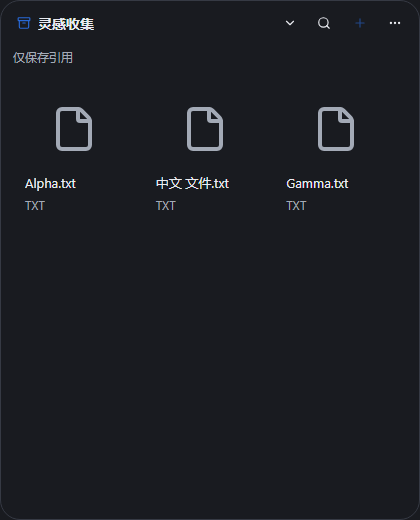
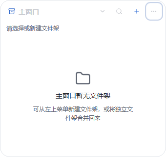

# P2 · 独立文件架与拆分合并

2026-10-25后续实测更新：[r13原生报告](P2-r13-native-results.md)。直接文件流转、拆合、中心和重启抽样通过，但**Dock入口投放FAIL R3**，置顶菜单恢复显示FAIL R2；总体未验收。下文“未Launch/未启动”为当时构建交付记录，现以该原生报告为准。后台修复继续同一PR #32，不自动合并。

2026-10-25。继续PR #32 / Issue #31，候选r13；不新增零碎PR，不直接改main。扩展r12，保留全部43项和根design.md的Operate设计合同。自动检查与精确包身份在[本轮证据](../research/P2-detached-shelves-evidence/r13-verification.json)记录，未执行的新Windows原生操作继续待验。

## 已实现的闭环

主架“更多→拆分为独立窗口”将当前架交给原生shelf-ID窗口；主架切换到剩余架。独立窗“合并回主窗口”恢复原主架并释放独立窗。持久、会话与绑定架均可拆合；不移动文件，不复制数据库，不删除引用、标签或手动顺序。所有架都可拆出，主架此时显示空状态和新建/独立窗口入口，禁止对不存在的架添加文件；没有额外保留一个不可拆的默认架。

独立窗沿用同一App、Store和Copy管线，固定自己的架ID；主窗快照排除已拆出的架，独立快照仅获取自己的架，在筛选架之后才探测绑定目录和文件。文件选择、拖入、原生Copy拖出、排序、标签、预览和默认打开复用已有实现。跨架引用复制仍用明确菜单，目标目录只能走既有安全Copy；不冒称卡片直接拖到另一个架已具备标签合并等全部语义。

Dock点击和管理中心“打开文件架”按已登记归属打开真实窗口。独立窗可收回入口，普通X依冻结第19项仅隐藏到托盘；主窗架菜单可重新打开独立窗。全部拆出后托盘仍可打开空主窗。独立窗不提供全局新建/绑定/关闭入口动作，仍可打开按需管理中心。常态沿用420×520、最小340×320，不新增常驻导航或工具条。

## 原生权限与状态

复用既有锁定Tauri2.12.5原生WebviewWindowBuilder、监视器/工作区/逻辑与物理坐标API，以及window-state2.5.0；不引入新依赖、复制外部业务代码或更改框架。来源和许可延续docs/third-party.md及现有source-provenance.json。已核对本机锁定Tauri的build.rs与生成ACL：core:default未授予create_webview/create_webview_window，窗口只由Rust创建。

能力列表增加限定命名空间shelf-*，不使用裸*。命名空间本身不授权文件操作：Rust要求正整数规范标签且在当前Layout登记归属，拒绝shelf-01、shelf-0、未知ID和其他窗口。独立窗对引用/缩略图/打开/重定位/拖出/标签/任务取消校验登记ID归属，校验发生在路径解析、stat、解码和对话框前；不能操作其他架的记录。manager仍只有元数据和桌面控制；入口没有路径操作。CSP与远程来源保持原规则。

进入和拖出分别记账，Leave不清掉进行中的自拖出；原生拖放期间拒绝拆合、切架、收起、X隐藏和完整退出，防止改变源/目标归属。并发拆合用短暂状态互斥，新原生窗口创建串行并二次检查；创建/显示失败回退原布局，合并销毁失败保留原归属，错误可见。原生构建在异步命令/任务完成，避免从Windows同步UI回调直接新建WebView。

每个独立窗保存位置、逻辑尺寸、置顶和显隐；主窗也记录位置/尺寸/置顶。移动仅更新内存，在动作/完整退出时持久化。新建窗口前先读取原记录，防止创建时的移动事件覆盖待恢复尺寸。恢复优先目标显示器工作区，按其DPI换算并纠偏；真实多DPI/断屏效果尚未验证。仅恢复上次可见独立窗，已隐藏或收回的架保持按需创建。

布局写独立desktop-layout-v3.json；优先读取v3，没有v3时读取v2或v1并转换，旧文件逐字节保留。损坏/未来版本不覆盖，临时状态有提示。SQLite仍schema1，无数据迁移。视图设置仍原v2格式，但每次仅合并当前架的最新值，其他窗口写入和恢复可见；未来格式不被降级覆盖。

## 验证与边界

r13精确功能源码3061d2077a59050eaf6bad643dfbc32869d2a930，CI构建f3212e6a1c6f75bff7373a99561f906fc4548027，完整tree同为461fa002250da7566b37edabbae1c84ee86c08db。云端[Desktop](https://github.com/2539426035852ningmao-cmyk/ningmao-file-workstation/actions/runs/40118543774)、[MSI](https://github.com/2539426035852ningmao-cmyk/ningmao-file-workstation/actions/runs/40118543743)、[Windows/Ubuntu仓库检查](https://github.com/2539426035852ningmao-cmyk/ningmao-file-workstation/actions/runs/40118543530)全部SUCCESS。Artifact12570449176，ZIP SHA256 b7a936e91b64e296169d6fe105d5803b3ead2e2ee9801d036bffe80c4561ab6b；本机r13白名单9文件/8哈希/PE/MSI只读核验通过。EXE18622976字节，SHA256 a7137619ced1e893e1e88931616d1a4a704bb64cf8168b796d6d9a32bdbbc867；MSI6389760字节，SHA256 407e1a02aa23c68e7486a57c60f4e98870ea9736aadec438d3c21f83dd8a10ed。268许可原文缺失0、既有映射警告1；debug未签名、需已有WebView，不是稳定发行。合成P2-acceptance-r3仅Prepare/Verify，5保护对象未变，未Launch。

先新增拆合用例，旧版实际因缺少菜单失败，再实现。当前本机61浏览器、31Rust（另2受控fixture按原设计忽略）、fmt/Clippy、生产构建和仓库检查通过；云端Windows/MSI与精确产物记录见证据。第一轮浏览器57/59通过，两个旧测试把重载后固定回第一个架当成前提；测试改为核对真实恢复的当前架，再明确切架检查原有排序/筛选断言，没有跳过或增设重试。新增回归覆盖全部拆出、空主窗新建、失败保留、独立快照、跨架引用和多窗设置。

以下为无头浏览器中合成数据的画面，不证明真实原生窗口已经打开：

交叉检查另外复现了设置写入受限时focus刷新丢失临时视图的问题，新增焦点回归先失败；修复为只在内存保留未保存的各架显示，接收其他窗设置时不冲掉临时选择。受限/未来格式仍不覆盖磁盘；写入恢复后下一次调整可保存。修复后的视图与拆合10项专项通过，最终完整云端检查另记精确提交。

新二进制未启动、未安装，不能继承r10原生通过结果。集中检查见[P2原生清单](P2-windows-acceptance.md)。剩余P2包括拖动自动吸边、可配置全局快捷键、实时显示器断开重连、完整智能聚合、资源/大规模性能采样与管理中心多媒体预览；当前拆合与位置算法不是完整P2验收。

回滚使用r12或普通revert，保留r10–r13、SQLite、原文件和v1/v2/v3布局。r12忽略v3并读取原v2；仅新v3内的拆合/位置不会显示在旧版，但引用/标签仍可读。不得删除用户数据或强推；PR仍Draft，不自动合并文件安全/权限/正式视觉/重大架构。Gemini #17仍UNKNOWN、0模型请求。后续线路保持P2完整验收→P3先LAN双设备确认/受保护传输/哈希→P4授权本地元数据能力及可选AI。
