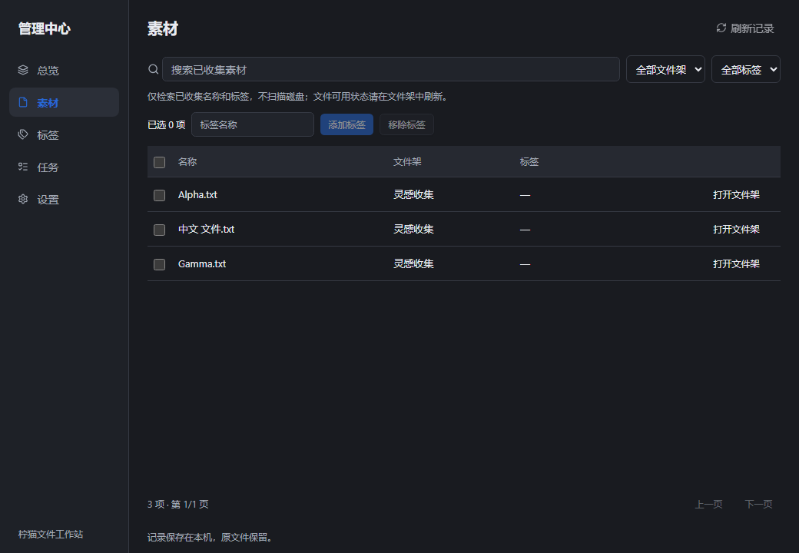

# P2 · 按需管理中心与贴边入口（r12）

2026-10-25。沿用PR #32 / feat/p2-desktop-loop，不新建零碎PR。扩展r11，保留r10/r11及其精确证据。源码、58浏览器/27Rust、Windows构建/MSI及本机包只读核验通过，Windows原生体验另验；完整P2仍未完成。[r12精确来源/CI/产物证据](../research/P2-management-edge-evidence/r12-verification.json)。

## 实际能力与复用

管理中心通过小文件架“更多→管理中心”按需创建独立manager窗口，默认1040×720、最小760×520；关闭时释放窗口，主架与复制任务继续。沿用Tauri2.12.5及window-state2.5.0，不新增框架、依赖或全局设置。窗口尺寸由原插件独立记录，保存恢复效果仍待原生验证。

界面为Operate模式，继承design.md、现有shadcn/Radix/Lucide、系统字体和深浅主题；保留左导航与素材表格，不改L1小架。首屏总览列实际文件架及已有复制任务；素材支持已收集名称搜索、架/标签过滤、每页100条、详情、批量添加/移除单个标签、打开所属文件架；标签页按真实记录定位素材；任务页显示最近20项并可请求取消当前复制；设置接真实贴边/自动收起/置顶及主题，不展示假AI或设备按钮。

management_snapshot只读SQLite中的现有引用、架身份与任务，不stat、不read_dir、不新增目录项目。标签API用ID和单事务，一次1–256项，缺失ID/标签超限整批回滚，保留其他标签、手动顺序与原文件；筛选隐藏的旧选择不参与。专用reference-tags-changed通知让主架只合并标签元数据，避免管理中心操作间接触发目录刷新。文件操作仍仅main可调用，manager仅元数据/桌面控制/已有任务取消，入口无文件路径命令。

## 原生入口与布局

设置提供自由悬浮、左侧贴边、右侧贴边；贴边模式固定入口，切回自由悬浮后可拖动。自动收起默认关闭，开启后保留18×64原生窗口内的18×56细柄；鼠标靠近恢复64px宽Dock；离开至少650ms且鼠标确实在入口外、没有native拖入时才收起。每次离开最多一个短暂休眠工作线程，无空闲轮询；只在收起前读取一次系统鼠标位置，不记录轨迹。目标WebView不销毁，native Enter/Over只唤出，Drop仍消耗一次冻结ID并复用原Import/Copy。

展开定位按目标显示器scale_factor计算，修正r11跨DPI宽度估算；负坐标、右边界、折叠/展开相同anchor及拖入不收起有自动检查。入口显示实际活动复制状态点，可开关置顶。真实OLE拖近/收起时序与多屏效果未验。

desktop-layout-v2.json保存设置与原有架/位置状态；首次读取v1后只写单独v2，v1原件保留。损坏/未来版本文件不覆盖，只使用临时布局；设置返回真实保存布尔值，保存失败显示“临时应用”，不误报持久成功。edge_hidden和drag_ids是瞬时状态，不写布局文件，edge_hidden单独出现在View事件中供界面渲染。SQLite保持schema1，无数据迁移。

## 验证与边界

先补功能测试，旧版实际因缺少管理中心入口失败，再实现。58浏览器、27Rust、fmt/Clippy、生产构建、Windows编译、MSI与双平台仓库检查通过；本机9文件白名单/8哈希/PE/MSI核验通过，未启动/安装。首轮Linux57项通过、贴边初态断言失败；修改测试为导航后移出指针、显式安排收起fixture再hover，保留全部断言且未改产品代码，随后58项完整通过。失败运行40113284086与修复后的运行均保留，未以重试或跳过掩盖。以下为无头测试工具中的合成数据画面，不能证明原生窗口已打开：

集中验收追加：管理中心打开/关闭释放和尺寸恢复；标签变更与原文件哈希；左/右贴边、鼠标/键盘唤出、native拖近/投放/Esc取消及主架接力；复制时状态点/取消；完整退出重启恢复v2及v1不变。仍需新候选原有多选/组Copy/Space/默认打开回归，不能继承r10结果。

未完成：多架独立展开窗口与拆分合并、拖动自动吸边/自由改变贴边纵向位置、逐架显示器与主架位置记忆、实时断屏/重连拓扑处理、可配置全局快捷键、完整智能聚合/分组、管理中心完整多媒体预览与SQLite大规模性能采样。现有元数据搜索不等于完整P4索引/AI。Windows10、DPI/多屏、创作软件、安装升级卸载、实际资源占用仍待测。

回滚使用保留候选/普通revert，不删数据库、原文件、v1/v2布局或旧环境。r11读取原v1并忽略v2，SQLite与标签可读；不自动安装、合并或发行。Gemini #17仍UNKNOWN、0模型请求；P3/P4继续按完整路线和各自授权门槛推进。
