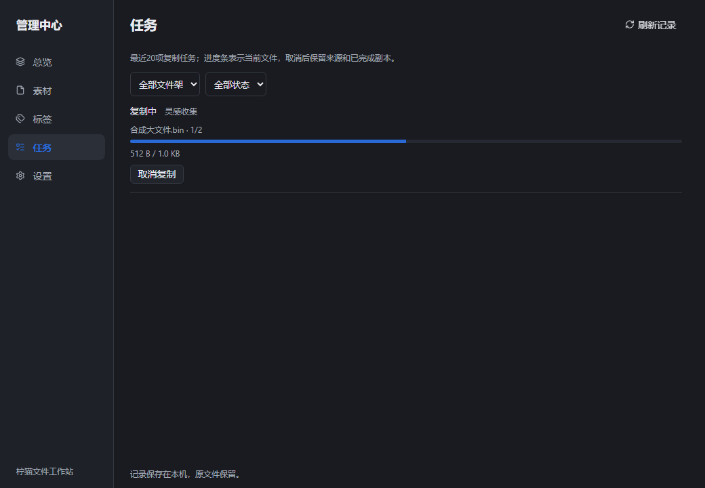

# P2 管理流程收束与下一候选

2026-10-26，独立分支feat/p2-management-flow，精确基线4774ff307dfa90bdf3cd26bc301992d27a36b160（PR #36）。不合并或重写祖先PR，保留r19及其用户验收记录；沿用43项决策与P2→P3→P4路线。默认后台，不操作正在运行的r19或私人数据。

## 本轮功能闭环

- 收集后跨架检索：管理中心按现有名称与已保存标签组合搜索，空白/大小写规范化，架/标签筛选继续叠加；不扫描目录，不改原路径、标签或手动排序。
- 复制任务：复用现有copy-progress/copy-finished事件和单活动复制任务事实，首个任务进度发现任务记录，同一任务后续进度不重复查库；当前文件名、批次序号、字节进度可读，终态不显示迟到进度。
- 任务查找与取消：按文件架和状态筛选最近20项；取消仍调用原有授权后端，等待时不重复请求，真实结束通知替代请求提示，不伪称已立即取消。

仅改管理中心呈现和现有事件消费，不新增后端权限/数据库格式/依赖/全局快捷键，不改Copy、来源保留、同名编号、原生拖放目标或文件回收逻辑。可通过revert本轮代码或使用旧隔离候选回退，禁止覆盖/降级数据库。

## 红测与验证

名称/标签检索测试在旧代码实际失败；实时任务发现测试先修正一次测试fixture的空存储问题，随后旧代码在缺少进度条的行为断言上失败。任务筛选/取消等待另行红测。最终绿态、构建源码和哈希在构建完成后填写，不能把此处计划当作通过。

## 独立门槛

r19用户通过只覆盖其精确包的视觉/窗口回归，本轮新候选不能继承。原生跨窗实时任务/取消、多窗开关释放、原生文件进出和完整Windows版本/DPI/多屏矩阵仍需验收。可配置全局唤出快捷键、实时显示器纠偏、P3双设备受保护传输与P4索引/AI仍按路线另行推进；首次LAN/账号费用操作未授权即不启用。

## 本地验证进展

名称/标签、实时任务、筛选/取消等待、首个字节之前的排队显示均完成实际红测。中间版本完整95浏览器通过；补齐排队事件后14个管理专项通过；最终全量与Windows构建在下述精确候选记录中补充。取消交互虽复用原后端，仍按R3保留原生验收，不自行下调风险。深浅管理中心截图为合成数据浏览器证据，不是Windows实机。

## r20精确交付

源码16edf9a02795bcfdfd1fe7e7a4eaf944c107cc3f；最终96浏览器通过，其中管理14项。Windows已构建并完成9文件/SHA256/PE/MSI只读核验，显式新合成Store fixture通过，未启动/安装。EXE `520a3dd95ee2ad01ecd8e6ccdbf85c8dfaaba0b52a6d4cea124dbe219e4f1b7b`，MSI `3576e7dff6e0e9b7fcd97e47351023b3ad8a4c1bda295b84fd48c3e94e7bf181`。Rust产品代码及依赖未改，未在本地重复完整Rust套件；云端随后验证。268条许可、原有1条映射警示保留。r19 EXE再次核对仍为0401c991…bc9182，旧数据未动。详见[机器记录](../research/P2-management-flow-evidence/r20-build.json)。

这些是无头浏览器画面，不是Windows原生证据。下一次集中验收只聚焦新管理链路（跨窗口开始任务→排队/进度→筛选→取消/完成→管理中心关闭再打开），并保留原生Copy/引用/Dock/窗口的专项回归；不把r19视觉通过继承为r20全量通过。默认后台，不为交付擅自弹窗。
